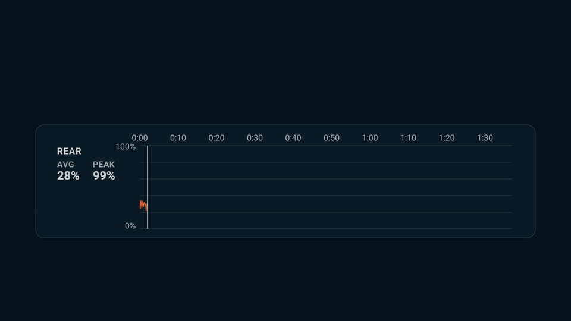
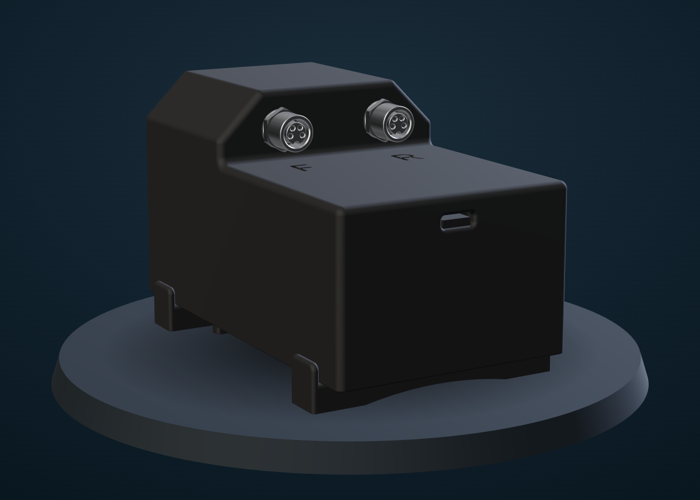

<p align="center">
  <picture>
    <source media="(prefers-color-scheme: dark)" srcset="brand/export/colour/dialed-wordmark-color-1200.png">
    
  </picture>
</p>

<p align="center">
  <a href="https://github.com/FLAVQUR/dialed-suspension-tuner/actions/workflows/build.yml"></a>
  <a href="https://github.com/FLAVQUR/dialed-suspension-tuner/tags"></a>
  <a href="https://github.com/FLAVQUR/dialed-suspension-tuner/compare/v0.1.0...main"></a>
  <a href="https://github.com/FLAVQUR/dialed-suspension-tuner/commits/main"></a>
  <a href="LICENSE"></a>
  <br>
  
  
</p>

<p align="center">
  A DIY suspension data logger for enduro and downhill mountain bikes.<br>
  An ESP32 on the bike records fork and shock travel, IMU and GPS on every run,<br>
  and its own web dashboard turns the data into tuning suggestions.
</p>



<sub>A real run on the dashboard: the rear shock bottoming out on a landing, and what to change.</sub>

The device rides on the bike and records every run. It logs suspension travel (a linear position sensor on the fork and one on the shock), an IMU and GPS to an SD card at 500 Hz, and serves its own web dashboard for reviewing a run, comparing two runs and tuning the suspension from what was recorded.

## The device

<p align="center">
  
</p>

<p align="center"><sub>The master box, v1. The fork and shock sensors plug into its two M8 connectors, marked F and R.</sub></p>

The enclosure is 3D printed. Its model and how this render was made are in [enclosure/](enclosure/README.md).

## Documentation

- [docs/prd.md](docs/prd.md) — what the product is for: who, goals, non-goals, requirements.
- [docs/architecture.md](docs/architecture.md) — how device and browser fit together, then the firmware: tasks and cores, the sampling loop, the clock.
- [docs/hardware.md](docs/hardware.md) — the bike, the pin table, the sensors and their calibration, the IMU's mounting and maths.
- [docs/sd-card.md](docs/sd-card.md) — how a run gets onto the card, and the long story of why writes failed.
- [docs/data-formats.md](docs/data-formats.md) — a run's `.CSV`, `.CSVB` and `.JSON`, and the web server's API.
- [docs/dashboard.md](docs/dashboard.md) — the web pages: shared UI, the run page, the tuning suggestions, the setup history.
- [docs/design-system.md](docs/design-system.md) — colours, type, spacing, components and chart rules.
- [brand/README.md](brand/README.md) — the logo: its versions, colours, files and rules, and how to rebuild them.
- [enclosure/README.md](enclosure/README.md) — the enclosure's 3D models, and how the turntable render is made from them.
- [docs/field-log.md](docs/field-log.md) — what each ride showed, and the suspension tuning that followed.
- [docs/troubleshooting.md](docs/troubleshooting.md) — problems that cost real time, and how to test on the device.
- [docs/decisions.md](docs/decisions.md) — what was decided and turned down, and why.
- [CHANGELOG.md](CHANGELOG.md) — what changed, by date.
- [todo.md](todo.md) — the working task list.
- [CLAUDE.md](CLAUDE.md) — working notes for the AI assistant: rules, commands, where things are.

## Layout

```
src/            firmware, one folder per module (suspension, imu, gps, run, storage, web, ...)
web/           the dashboard (HTML, CSS, JS) — becomes the device's LittleFS image
tools/          build scripts run by PlatformIO; tools/bench/ scripts run by hand against the device
brand/          the logo kit: masters, exports, web icons, generated by brand/export_all.sh
enclosure/      the enclosure's 3D models (STL) and renders of them
tests/          tests for the dashboard's maths (node --test), with three real runs as fixtures
platformio.ini  board, libraries and build options
.github/        the build workflow (GitHub Actions)
```

## Building

The project builds with [PlatformIO](https://platformio.org/) (`esp32dev`, Arduino framework). Two files hold secrets and this machine's settings, and are not in the repository; create them from their examples:

| Copy | To | What to set |
|---|---|---|
| `src/config/secrets.example.h` | `src/config/secrets.h` | The OTA password the firmware will ask for |
| `platformio.local.ini.example` | `platformio.local.ini` | The device's address and the same password |

The firmware does not compile without `secrets.h`. `platformio.local.ini` is optional: without it, uploads go over USB.

```
pio run               # build the firmware
pio run -t upload     # upload the firmware, then the dashboard (web/)
pio run -t uploadfs   # upload the dashboard only
```

A board that has never run this firmware has to be flashed over USB once; after that, uploads can go over the air.

**On GitHub**, every push to `main` and every pull request is built from a clean checkout (`.github/workflows/build.yml`): the firmware and the dashboard's filesystem image, with the example secrets in place of the real ones. The build badge at the top is its result; the two images are kept for 30 days as the run's artifact. Built with a placeholder OTA password, they are for checking the build, not for flashing a bike.

## Versions

Since 2026-10-08 a build says what code it is, not only when it was made.

- **The version is `git describe --tags --always --dirty`**: last tag, commits since it, the commit, and `-dirty` when the build included uncommitted changes — `v0.1.0-3-gabc1234-dirty`. `tools/version_stamp.py` (a `pre:` script) works it out on every build, together with the build's date and time (local), and writes both to `include/version_stamp.h`, which is not in the repository. Only `src/system/version.cpp` includes it. That is what fixed the old stamp's flaw: `__DATE__`/`__TIME__` lived in `version.h`, so the "build time" was the compile time of `server.cpp` and did not move when a build changed other files.
- **Releases are tags** (`v0.1.0` is the commit that introduced this). Nothing is bumped by hand; tag a commit when it is worth a name — a build validated on a ride, say. The "commits since" badge at the top names the tag in its URL: move it to the new one.
- **Where it shows**: Settings → System has a line for the firmware and one for the dashboard (`/api/system` → `device.firmware_version` / `firmware_build`; the pages' own stamp is `version.json`, which `gzip_web_files.py` writes into the filesystem image — there is no such file in `web/`). Every run's `.JSON` gets `firmware` and `firmware_build`, shown at the bottom of the run page; a run recovered at boot gets neither, because the firmware recovering it is not necessarily the one that recorded it.
- **`pio run -t upload` uploads both** the firmware and the dashboard (`tools/upload_both.py`, a `post:` script: after an OTA upload it waits for the device to answer `/api/status` again, then runs `uploadfs`). The rider's rule, 2026-10-08: always upload both, even when one did not change, rather than have the device warn about a mismatch — a compatibility check between the two was considered and turned down. The two lines in Settings are how to see that they match; the dashboard's time is some seconds after the firmware's.
- A build with no git available (or outside a repository) is stamped `unknown` instead of failing.

## Repository

Under git since 2026-10-08, branch `main`. On GitHub it is `FLAVQUR/dialed-suspension-tuner`, **public**, MIT licence (private at first; public by 2026-10-25).

- **What is not in it**: `src/config/secrets.h` (the OTA password) and `platformio.local.ini` (the device's address and the same password, as `--auth`). Each has a committed `.example` next to it. `platformio.ini` pulls the local file in with `extra_configs`; a missing file is skipped without a word, and uploads then go over USB. The password was moved out before the first commit, so no commit contains it — which is what made it safe to make the repository public.
- **Line endings**: 27 of the files were CRLF and the rest LF. `.gitattributes` (`* text=auto eol=lf`) makes the repository store LF everywhere; a CRLF file in the working folder becomes LF the next time git writes it.
- **A fresh clone's first two PlatformIO commands**: the first build creates `include/version_stamp.h`, and PlatformIO cleans the whole build directory when the project's file list changes between two runs, so a `pio run -t buildfs` right after the first `pio run` wiped the firmware it had built (found 2026-11-07, setting up the build workflow, on a clean clone). Harmless on a working copy, where the file already exists; the workflow creates it empty before building.
- Also ignored: `.pio/`, the VS Code files the PlatformIO extension regenerates, `.claude/settings.local.json`.
- **Platform and libraries are pinned to exact versions** in `platformio.ini`. The fresh clone made when the project left OneDrive (2026-10-08, see [CHANGELOG.md](CHANGELOG.md)) was the first build ever made without the old folder's `.pio/`, and it failed: `fastled/FastLED@^3.10.3` resolved to 3.10.6, which is 390KB bigger, and the firmware came to 115.6% of its partition instead of 85%. Nothing had warned of it, because an existing `.pio/libdeps` keeps whatever was installed first. With `espressif32@7.0.1`, FastLED 3.10.3, ArduinoJson 7.4.3, TinyGPSPlus 1.1.0 and the BNO08x library 1.0.6 pinned, a clean build gives the same binary as before. A library upgrade is now a deliberate change — and FastLED's needs its size looked at first.

## License

MIT — see [LICENSE](LICENSE).
