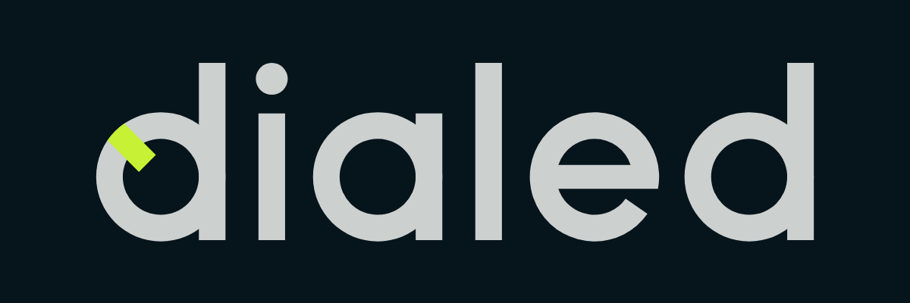

# Dialed — Logo

> [!NOTE]
> **In short.** The logo is a geometric lowercase **d** whose bowl is an adjuster dial: one mark across its rim, set to the click that works. It is the first letter of the wordmark **dialed**, so the symbol and the name are one thing. The primary logo is light on dark: **Fog** `#CCD0CF` with the mark in **Lime** `#C6F135`, on **Ink** `#11212D` or the dashboard's dark page. On light backgrounds it is **Ink alone**. Every file is generated by [`build_logo.py`](build_logo.py) and [`export_all.sh`](export_all.sh); change them, never the files by hand.

## Versions

| Version | Use it for | Colour (on dark) | One colour |
|---|---|---|---|
| Wordmark | the default: page headers, documents, anywhere there is width | [`dialed-wordmark-color.svg`](master/dialed-wordmark-color.svg) | [`dialed-wordmark.svg`](master/dialed-wordmark.svg) (Ink), [`-reversed`](master/dialed-wordmark-reversed.svg) (Fog) |
| Stacked | square-ish spaces: a sticker, a splash screen, a shirt | [`dialed-stacked-color.svg`](master/dialed-stacked-color.svg) | [`dialed-stacked.svg`](master/dialed-stacked.svg), [`-reversed`](master/dialed-stacked-reversed.svg) |
| Symbol | where there is no room for the name: avatar | [`dialed-symbol-color.svg`](master/dialed-symbol-color.svg) | [`dialed-symbol.svg`](master/dialed-symbol.svg), [`-reversed`](master/dialed-symbol-reversed.svg) |
| App icon | the symbol on its Ink tile | [`dialed-app-icon.svg`](master/dialed-app-icon.svg) | |
| Favicon | 48px and below: the small cut on an Ink tile | [`dialed-favicon.svg`](master/dialed-favicon.svg) | [`dialed-symbol-small.svg`](master/dialed-symbol-small.svg) |

- **Colour versions are for dark backgrounds only.** Lime on white is 1.3:1: on light, use the Ink one-colour version.
- **The one-colour versions have the same silhouette.** The mark runs across the ring, so in one colour it merges into it and only the part inside the counter shows: nothing has to be redrawn for black, white, embroidery or a stamp.
- The Fog versions (colour and `-reversed`) are drawn **1 unit thinner** (21 instead of 22), because light shapes on dark look heavier than they are.
- In the wordmark the dial is on the first **d** only. In the stacked version the symbol carries it, so the wordmark below it has a plain d: the dial appears once.

## Files

| Folder | What is in it |
|---|---|
| [`master/`](master/) | the SVG masters above |
| [`export/colour/`](export/colour/) | the colour masters and their PNGs (symbol and app icon 1024, wordmark and stacked 1200; the wordmark also on the dark page) |
| [`export/one-colour/`](export/one-colour/) | symbol, wordmark and stacked in black, white, Ink and Fog, SVG and PNG; a square symbol for avatars |
| [`export/web/`](export/web/) | `favicon.svg`, `favicon.ico` (16/32/48), `favicon-16/32/48.png`, `apple-touch-icon.png`, `icon-192/512.png`, `maskable-512.png`, `site.webmanifest`, and `head-snippet.html` with the `<link>` tags |
| [`board/`](board/) | the presentation: [`board.html`](board/board.html) and one PNG per slide in [`slides/`](board/slides/) |

To rebuild everything: `sh brand/export_all.sh` from the repository root. It needs the [logo-design skill](https://github.com/kaankiziltug/logo-design-skill) installed at `~/.claude/skills/logo-design`.

The favicon is the colour logo **on its Ink tile**, so it shows in a light browser tab as well as a dark one. The app icons are full-bleed Ink squares; the phone rounds the corners itself.

> [!IMPORTANT]
> **The dashboard uses three of these**: `favicon.svg`, `favicon.ico` and `apple-touch-icon.png`. `export_all.sh` copies them into `data/`, and each has its own route in `serverInit()`; a fourth would need a route too (a firmware build). The manifest and the 192/512px icons are not used: they only serve "install as app", which browsers offer on HTTPS only (see [decisions.md](../docs/decisions.md#dashboard)). How they are served is in [dashboard.md](../docs/dashboard.md#files-and-scripts).

## Construction

Every letter is built from a few parts on one grid (units: baseline 0, x-height 100, ascender 140):

- **Ring**: outer radius 51, stroke 22. It passes the baseline and the x-height by 1 unit, so round letters don't look smaller than flat ones.
- **Bar**: 22 wide. A bowl letter's stem lines up with the ring's outer edge.
- **The e's bar**: 20 high, and the e is drawn as one outline, so the bar's end follows the outer circle. Drawn as a separate rectangle, its square end stuck out past the curve by about 1 unit (seen by the rider on the first build).
- **The mark**: 20 wide (10% thinner than the stroke, because a bar across a counter reads heavier), at half past ten (−135°). It starts 15 units inside a counter of radius 29 and runs across the ring to its outer edge, its end following the circle. In colour it is painted over the ring.

Letter spacing is optical, not even: 26 between two stems (d|i, a|l), 22 from a stem to a bowl (i|a, l|e), 20 from the e to the last d.

The **small cut** has a 24-unit stroke and a 13-unit mark and fills more of the square, so the counter stays open at 16px. In one colour, below about 24px the mark disappears and what is left is a plain d. In colour, the lime still shows at 16px as a pixel or two on the rim.

No font is involved: every letter is drawn, so there is no font licence to worry about.

## Colour

| Name | Role | HEX | RGB | CMYK (naive conversion) |
|---|---|---|---|---|
| **Ink** | the app-icon and favicon tile; the one-colour logo on light backgrounds | `#11212D` | 17 33 45 | 62 27 0 82 |
| **Fog** | the logo on dark backgrounds | `#CCD0CF` | 204 208 207 | 2 0 0 18 |
| **Lime** | the dial's mark, in the colour versions only | `#C6F135` | 198 241 53 | 18 0 78 5 |

Ink and Fog are steps of the dashboard's base palette (see [design-system.md](../docs/design-system.md#colour)). Lime is the logo's own.

> [!IMPORTANT]
> **Lime belongs to the logo and nothing else.** In the dashboard, colour means data or status: lime is never a series, a status, a button or a highlight. It was chosen because it matches none of them (the nearest, `--good` `#22c55e`, is a much bluer green).

| Pair | Contrast |
|---|---|
| Fog on the dark page `#06141B` | 12.0:1 |
| Fog on Ink | 10.5:1 |
| Lime on Ink | 12.5:1 |
| Lime on the dark page | 14.3:1 |
| Lime on Fog (the mark against the ring) | 1.2:1 |
| Ink on white | 16.4:1 |
| Ink on the light page `#E6E9E8` | 13.4:1 |

The mark is told from the ring by hue alone (1.2:1). Anyone who can't separate lime from grey sees the one-colour logo, which is also correct.

> [!WARNING]
> **Ink on `#253745` is 1.3:1**, so the Ink logo vanishes on the dashboard's border and surface-alt greys. On anything darker than the light page, use a Fog version.

The CMYK values are a plain RGB conversion, not a print profile, and no Pantone match has been checked against a swatch book. Lime in particular is brighter on screen than most inks can print. Get a proof before printing anything that matters.

## Clear space and minimum size

- **Clear space**: half the x-height (the radius of the d's bowl) on every side, scaled with the logo.
- **Minimum size**: the wordmark 72px wide (its x-height is then about 12px); the symbol 16px, using the favicon (small cut) from 48px down.

## Don't

- Stretch, squash, rotate, or set the wordmark in a font: it is drawn, not typed.
- Use the colour version on a light background, or lime anywhere but the mark.
- Recolour it outside Ink, Fog, Lime, black and white, or add shadows, outlines or gradients.
- Move the mark, or add a second one. One click, set.
- Put the dial on both d's of the wordmark, or next to a symbol that already has it.
- Put the Ink version on a mid-grey or a busy photo: use a Fog version on a calm, dark area.

How it was made and checked (2026-11-07)

Made with the logo-design skill (v1.4.5), fast track. The brief was taken from the project: a DIY MTB telemetry tool for a rider who tunes their own suspension; precise, honest, technical, calm; it must work as a 16px favicon, in one colour and on the dashboard's dark page. Off-limits as clichés: mountains, bike silhouettes, coil springs, speedometers, a bare heartbeat line.

Three concepts were shown in greyscale:

- **Dial d** (this one).
- **Sag D**: a capital D filled to 30%. Turned down: the idea only reads to someone who knows what sag is; to anyone else it is a bottom-heavy D. Drawn with a bar across instead, it read as the letter Đ.
- **Settle**: a suspension trace in shrinking half-circles that runs out flat. Turned down: the closest to the heartbeat-line cliché, a line going flat can read as a flatline, and it is a squiggle at 16px. With a dot at the end it looked like a worm.

The rider chose Dial d. The first kit made Ink the main colour; the rider found the dark logo hard to read in use and preferred it light on dark, as on the app icon. So Fog on dark became primary, and the mark got an accent:

- **Where the colour runs**: inside the counter only (as first drawn), from the counter across the rim to the edge, or on the rim only. Across the rim won: it reads as the mark painted on an adjuster knob, it is the one that still shows at 16–32px, and in one colour it collapses to the original silhouette. The rim-only version was finer at large sizes but was lost from 32px down.
- **Which colour**: every hue in the dashboard is taken (fork blue, shock orange, GPS violet, IMU aqua, highlight pink, and green, amber and red for status). Tried: lime, signal orange `#FF6A2B`, cyan, yellow, then, to warm it, citron `#E4EC3C`, brass, apricot and coral. Orange looked fine beside a fork/shock chart, but orange in suspension says Fox. Brass is Öhlins gold and gets lost against Fog; apricot merges with Fog at 32px; coral sits between the dashboard's red and pink; cyan between fork blue and IMU aqua; yellow next to the warn amber. Citron was the recommendation as a warmer lime; the rider chose **lime**.

Checks on the final masters: `svg_audit.py` (100/100 on every master: fills only, integer canvases, no text, no strokes, no near-miss angles), `preview_sheet.py` (size ladder, 16/32/48px pixel test, one colour, reversed, backgrounds, blur), and a headless sheet of the favicon in a light and a dark tab, the colour and one-colour versions side by side, and the maskable icon inside its circle. A risk found on the way: at 64–96px the mark in the counter can read as a pupil, so the d looks like an eye. No trademark search has been made.

The board's browser-tab mockup prints `https://<brand>.com`; `export_all.sh` points it at `http://dialedtuner.local` instead, because `dialed.com` is not this project's.

