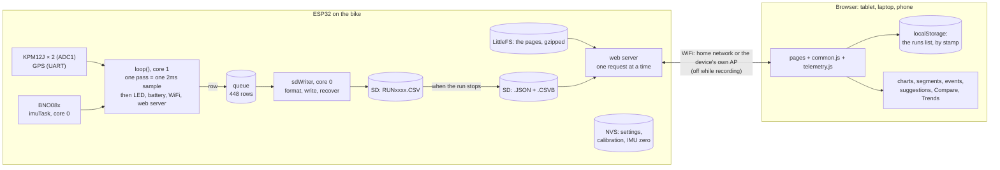

# Dialed — Architecture

How the system is put together — device and browser — and then the firmware in detail: what runs where, the sampling loop, the clock. The pins and the sensors are in [hardware.md](hardware.md), the SD write path in [sd-card.md](sd-card.md), the files a run leaves and the API in [data-formats.md](data-formats.md).

## Project

**Dialed** — a DIY ESP32-based MTB suspension telemetry and tuning helper for enduro/downhill. (The project was called "Bike Telemetry", and the dashboard "Bike Logger", until 2026-10-08.) It logs GPS, IMU and suspension travel (two **KPM12J linear position sensors** — 200mm stroke at the front, 75mm at the rear) to CSV at **500Hz** (exactly, since the sampling loop was rewritten on 2026-10-07; ~385Hz before that), with a web dashboard served by the device itself (`data/*.html`) and firmware in `src/`.

The original idea of two rotary potentiometers used as string-pots was abandoned; the KPM12J sensors bolt alongside the fork/shock and their rod follows the travel directly.

**Phase**: the infrastructure phase ended with the 2026-09-28 field test. Work is now data interpretation and suspension tuning from real trail runs, not firmware plumbing.

**Known gap — air springs only** (noted 2026-10-19): the setup, the tuning suggestions and the setup history all assume an air fork and shock (pressure, volume tokens). A coil spring's rate and preload have nowhere to go, and the suggestions' spring-side advice is all pressure and tokens. Not built: no coil-sprung bike to test on. What would change is listed in `todo.md`.

Dashboard pages: `index.html`, `runs.html`, `run.html` (Overview/Analysis/Tuning tabs), `compare.html`, `trends.html`, `settings.html` (Bike/Sensors/WiFi/System tabs), sharing `style.css` and `common.js`, plus `telemetry.js` on the three pages that open a run. The dashboard is designed for **tablet / laptop / PC first**; the phone layout is a fallback.

## System overview

Two halves: the device on the bike records and serves files, and the browser does nearly all of the analysis.

- **While recording**, the radio is off (by default), so nothing competes with the sample clock. `loop()` takes a sample every 2ms and only queues the row; the writer on the other core formats it and writes it to the card, and recovers from a failed write without losing rows ([sd-card.md](sd-card.md)). The headline figures (`stats`) are added up sample by sample as it goes.
- **When the run stops**, the device writes the run's `.JSON` (setup snapshot, stats, counters) and a compact `.CSVB` for the dashboard. The `.CSV` stays as it was, readable in a spreadsheet ([data-formats.md](data-formats.md)).
- **Everything else is worked out in the browser**: decoding the `.CSVB`, the bike-frame angles and vertical G, gaps and lost orientation, trail segments, events, tuning suggestions, the setup history. The device has neither the memory nor the CPU to spare, and keeping it in JavaScript means a run recorded long ago is re-read with today's analysis.
- **Where things live**:

| Where | What |
|---|---|
| NVS (flash) | live settings, suspension calibration, IMU zero, WiFi |
| SD card | runs (`.CSV`, `.JSON`, `.CSVB`), bike profiles (`/bikes/*.json`) |
| LittleFS (flash) | the web pages only, gzipped at build time |
| Browser `localStorage` | the runs list, kept by stamp; the last theme seen |

- **The clock** comes from GPS, NTP or the browser, the most trusted one available (see [the clock and run dates](#the-clock-and-run-dates-added-2026-10-0607--field-validated-2026-10-10)). Durations never depend on it.

## Platform, tasks and cores

ESP32 DevKit (`esp32dev`, Arduino framework, PlatformIO), dashboard on LittleFS, firmware uploaded over OTA (`espota`; the upload settings are in `platformio.local.ini`, which is not in the repository, with the USB/`esptool` lines commented out there for recovery).

The pin table is in [hardware.md](hardware.md#pins).

**Tasks and cores**:
- `loop()` on core 1: **one pass is one sample period, and the sample comes first** — it waits for the sampling clock, reads the suspension, logs the row, and only then does everything else (LED, battery, GPS, WiFi, OTA, web server) in what is left of the period. It never blocks on SD: `RunService::log()` only copies the row into a 256-deep queue. See [The sampling loop](#the-sampling-loop-rewritten-2026-10-07--ridden-on-2026-10-10-500-rowss-none-dropped).
- `sdWriter` task on core 0 formats and writes the CSV (see [sd-card.md](sd-card.md)).
- `imuTask` on core 0 polls the BNO08x and is **never registered with the watchdog** — a misbehaving IMU costs only IMU data. Keep this isolation regardless of wiring quality.
- 8s task watchdog on `loop()`; core 0's idle watchdog is disabled (`disableCore0WDT()`) so a hung card stalls the CSV instead of rebooting.

**Sampling rates — what is actually in a row**:
- The Settings page offers 500 or 1000Hz (`suspensionSampleRateHz`, default 500). **Since 2026-10-07 the device delivers the configured rate: 500 rows in every full second, stamped exactly 2ms apart.** Every run up to RUN0047 was recorded at whatever `loop()` managed — ~385Hz on the trail, with rows 2 or 3ms apart. ⚠ The 1000Hz option used to change nothing; it now really doubles the row rate, and that is untested — so Settings labels it **"1000 Hz (Beta)"** (the rider's choice over hiding it), and making it dependable stays parked in `todo.md`.
- **Dropped rows are now visible.** `rows_dropped` (samples the SD writer could not take — the likely way 1000Hz would fail) used to be readable only in a run's `.JSON`; `/api/runs` now returns it and the Runs list shows a "Rows dropped" badge. `incomplete` still does not cover it.
- The IMU reports at 100Hz (`IMU_REPORT_INTERVAL_MS = 10`), deliberately below its hardware ceiling. IMU and GPS columns repeat their latest cached value between their own updates, so only the travel columns carry new information on every row.
- The CSV columns, the run `.JSON` and the `.CSVB` are described in [data-formats.md](data-formats.md).

**IMU bus history**: migrated from I2C to SPI on 2026-09-12 to remove ~40% of `loop()` overhead. 3MHz was tried and broke; it stays at 400kHz. IMU resets track Wi-Fi activity rather than runs (zero resets with Wi-Fi off), and `wifiOffWhileRecording` is on by default, so field runs are largely unaffected.

## Names on the network

- **The rename to Dialed** (2026-10-08) covered the documents, the pages' `<title>`s and the device's names on the network: mDNS `dialedtuner.local` (was `bikelogger.local`), OTA name `dialedtuner` (was `esp32-bike`), default hotspot `DialedTuner-XXXX` with password `dialedtuner` (were `BikeLogger-XXXX` / `bikelogger`). The hotspot name and password are only defaults — a device that has saved its settings keeps the old ones in NVS until they are changed in Settings or connectivity is reset with the 10s button press. The longer hotspot name no longer fitted the 16-byte buffer it is built in (`defaultApSSID()`), which would have cut the MAC suffix short without any error; the buffer is 24 now. Left alone on purpose: the NVS namespaces `bike` and `net` — renaming one makes the device start from defaults, calibration included.

## The sampling loop (rewritten 2026-10-07 — ridden on 2026-10-10: 500 rows/s, none dropped)

The rider's brief: optimise what runs inside `loop()` and get closer to the configured 500Hz; 1000Hz stays parked.

**What the profile showed.** Each section of `loop()` was timed on the device during a recording (`/api/debug/loop`, see "How to test" in [troubleshooting.md](troubleshooting.md#how-to-test-and-work-on-the-device)). The rate had never been designed — it was whatever one pass of `loop()` took:

| Section | Per pass | Share | Why |
|---|---|---|---|
| Suspension | 2806µs | 79% | eight `analogReadMilliVolts()` calls a sample at ~350µs each — the Arduino core re-attaches the pin and rebuilds the calibration curve from eFuse on every call |
| LED | 317µs | 9% | `FastLED.show()` on every pass, nearly always for the colour already showing |
| Logger | 161µs | 5% | TinyGPS++ double-precision maths (software on the ESP32) for values that change a few times a second |
| GPS | 117µs, worst 122ms | 3% | see the GPS stall in [troubleshooting.md](troubleshooting.md) |

On top of that, the suspension sample and the logger's row were on two separate `millis()` timers, each restarting from whenever it fired: lateness piled up, and a row could repeat a sample or skip one.

**The ~400 rows/s ceiling itself was the LED library** (found later the same day, during the SD tests: with the old LED behaviour switched back on, the *new* loop ran at exactly 399.9Hz). FastLED will not send a WS2812 two frames less than 2.5ms apart — 400 a second — and waits out the difference inside `show()`. With the LED written on every pass, no pass could be shorter than 2.5ms whatever else was optimised: that is the 398 rows/s of RUN0041. The ADC reads then pushed the pass past 2.5ms and the rate below it.

**What it is now.**
- **`fast_adc`**: the pin is attached and the calibration curve built once; a reading is the conversion plus the lookup, ~43µs. Same attenuation, width and reference as `analogReadMilliVolts()`, so the numbers are the same and existing calibrations stand — checked at rest before and after: front 301mV, rear 613mV, battery 4.23V. The battery read uses it too.
- **One sample clock** (`suspensionUpdate()`): a sample is due every period counted from when the previous one was *due*, not from when it was taken, so a late sample shortens the next gap instead of delaying everything after it. On the 64-bit `esp_timer` clock (`micros()` wraps every 71 minutes). If `loop()` falls a whole period behind, the clock restarts from now rather than firing a burst.
- **The logger writes one row per sample**, stamped with the time that sample was due — so rows are exactly one period apart in the file. (The read itself happens a few µs after that time.)
- **`loop()` is one sample period, sample first** (`suspensionWaitUntilDue()` → sample → row → everything else). The housekeeping can no longer make a sample late; the worst it can do is overrun into the next period, which the clock absorbs.
- **LED** written only when its colour changes, plus once a second so a glitched pixel heals.
- **GPS**: 1KB UART buffer (was 256 bytes = 66ms of NMEA), one bounded non-blocking read per pass, and the logged values cached as floats when a sentence arrives. The run's distance is only added to when the position has moved (it was a haversine per row).

**Measured** (timed bench runs, bike stationary, no GPS fix):

| | Before (same day's build) | After |
|---|---|---|
| Rows in each full second | 283-288 | **500** |
| Spacing between rows | ~3.6ms | 94% within ±10µs of 2000µs, 99.9% within ±50µs |
| Work per pass | 3548µs | 426µs of a 2000µs period — **79% of the period is headroom** |
| Logger, per row | 161µs | 20µs |
| Worst GPS pass | 122ms | 0.2ms |

A 60s run: 29,939 rows, 29,936 of them exactly 2ms after the previous one, none dropped, writer averaging 396µs a row and absorbing one 218ms flush.

**The start of a run** (changed the same day, after the above). The WiFi radio used to be shut down half a second *into* the run, inside `loop()`, which left a 75-115ms hole in every recording. Now **WiFi goes down before anything touches the card** (the rider's call: "take the WiFi down before any file write"):
- `RunService::start()` calls `recordingPrepare()` first — radio off when `wifiOffWhileRecording` is set — then opens the file and starts. `recordingRelease()` brings the radio back when the run ends, or at once if the file could not be opened. A start from the button is exactly this.
- A start asked for over the network cannot do that in the request handler: its own answer has to get out through the radio first. `RunService::startSoon()` schedules the start 500ms ahead (`NETWORK_START_DELAY_MS`) and `RunService::update()` carries it out; `/api/run/toggle` and `/api/run/timed` both go through it. While it is pending, `/api/status` already says `recording` with the name the run will get, a second toggle calls it off, and a press of the button starts the run at once.
- Consequence: `/api/run/toggle` can no longer answer 500 when the run's file cannot be opened — it has answered before the attempt. The device just stays idle, with WiFi back.
- Measured: a 12s timed run gave exactly 6000 rows, 500 in every second including the first, every spacing between 1.92 and 2.07ms, the longest pass 0.93ms. The rider's own start/stop tests the same day — RUN0048 and RUN0049, one from the button and one from the dashboard — have every row exactly 2ms after the previous one from the first second on (9051 of 9051 and 6911 of 6911), none dropped.

**With a GPS fix** (2026-10-07, bike on a balcony, 11-12 satellites; RUN0050 from the button, RUN0051 from the dashboard): a fix on every row, every row exactly 2ms after the previous one (4642 of 4642, 7650 of 7650), none dropped. Loop profile of RUN0051: busy 532µs a pass on average and 1105µs at worst, GPS 45µs a pass (worst 163µs), 99.9% of row spacings within ±50µs of 2000 (64% within ±10µs — a little looser than without a fix, where it was 94%).

**What is still there.**
- **Not measured yet**: a real ride — minutes of vibration with the SD card taking ~46KB/s instead of ~35, which is when its hiccups happen. The queue to the SD writer covers 0.51s at this rate (it was 0.66s); `rows_dropped` in a run's `.JSON` is the number to watch.
- The wait for the next sample is a busy spin, as `loop()` always was. Sleeping through most of it would save battery; not done, to keep the timing change small.
- The idle device (WiFi on) samples at ~496Hz: the web server's own 1ms idle delay uses most of each period.

## The clock and run dates (added 2026-10-06/07 — field-validated 2026-10-10)

**The device has no RTC**, so after every power-up it does not know the date until something tells it. `src/system/clock.cpp` takes the time from whichever source shows up first and then lets the system clock run:

| Source | When it is available | Trust |
|---|---|---|
| GPS (`gpsUpdate()` in `gps.cpp`) | date/time decoded from NMEA, usually before a position fix; not indoors | highest |
| NTP (`clockStartNtp()`, on STA connect) | home network with internet | middle |
| Browser (`POST /api/time`, sent by `common.js`) | whenever a dashboard page is open — the only one in AP mode with no sky | lowest |

- A source is never overridden by a less trusted one. GPS re-syncs every 10 minutes.
- Nothing is timed with it — durations and `timestamp_ms` stay on `millis()`.
- Each run's `.JSON` gets **`start_utc`** (epoch seconds, UTC), computed at `stop()` as *now − duration*, so a run that only learned the time mid-ride is still dated. It is absent when the clock was never set, and on every run recorded before this (RUN0042-RUN0046). The browser shows it in local time, always as `dd/mm/yyyy hh:mm:ss` — `formatRunDate()` in `common.js`, used by the runs list and the run page. That format is the rider's choice (2026-10-07), written out field by field on purpose: don't go back to `toLocaleString()`, which changes shape with the browser's language.
- `/api/status` reports `clock: { set, source, epoch }`; Settings → System → Device shows it.
- Checked on the device: NTP set the clock within seconds of boot and matched the PC; the browser's offer was then refused, as designed. **`start_utc` lands in a run** (RUN0047, 2026-10-07, clock from NTP): 11:42:56 local, which is where the device's uptime and the download time put it, and the date shows in the runs list and on the run page. **The GPS path works** (2026-10-07, bike on a balcony with a fix and 12 satellites): the source went from `ntp` to `gps` and the device's time matched the PC's to the second. **An accepted browser time** (AP mode, no sky) was the last path left, and it worked at the trail on 2026-10-10: the rider's phone set the clock, and GPS took over once it had a fix. RUN0047–50 are dated.
- `gpsUpdate()` runs in the sampling loop, but the clock sync is only looked at when a new NMEA sentence has just arrived (a few times a second), and costs one `settimeofday()` per sync. RUN0047's lower rate (~375Hz against ~385) was first suspected of being this; it was not — see [The sampling loop](#the-sampling-loop-rewritten-2026-10-07--ridden-on-2026-10-10-500-rowss-none-dropped).
