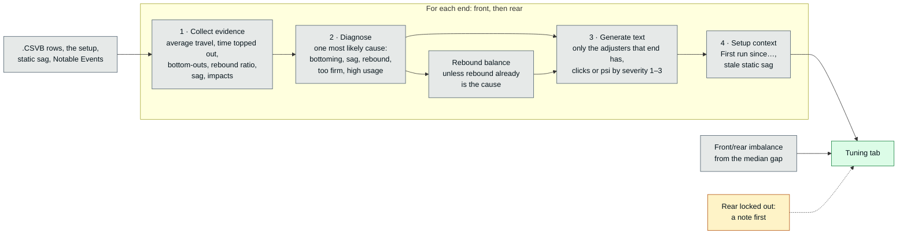

# Dialed — Dashboard

The web pages the device serves (`web/`): shared UI, the run page, the tuning suggestions and the setup history.

> [!NOTE]
> **In short**
> - Six pages served by the device from LittleFS, gzipped, sharing `style.css`, `common.js` and, where a run is read, `telemetry.js`.
> - Desktop first. From 1024px a side rail replaces the top bar and nothing floats over the content.
> - The run page: a stats strip, the route map pinned beside seven charts on one time axis, zoom by dragging or by clicking a segment or an event.
> - Tuning suggestions in three phases (evidence → diagnosis → text), with what the setup history knows under each.
> - "Copy for AI" on the Tuning tab puts the run on the clipboard as a prompt, for a second opinion from a language model.
> - The setup history is worked out from the runs themselves; a run's recorded setup can be corrected afterwards.
> - How things look — colours, type, components, chart rules — is in [design-system.md](design-system.md).

> [!IMPORTANT]
> - **A new file in `web/` needs a route**: each web file is served by its own `serveWebFile()` route in `serverInit()`, i.e. a firmware build.
> - **A page's script must not declare a top-level `const`/`let` that `common.js` or `telemetry.js` already declares**: that is a SyntaxError and the whole page script fails to run.

## Shared UI (overhaul of 2026-10-06/07)

**Brief from the rider**: tablet / laptop / PC first — the app is chart- and analysis-heavy, and the phone is a nice-to-have. Modern, clean, organised. UI text stays in English.

Checked on real screens by the rider (2026-10-07)

**Checked on real screens by the rider (2026-10-07)**, after everything up to that point had only been seen in headless Edge: every page opens in the tablet's and the phone's own browsers (with the files served gzipped); the "Recording — WiFi is off" banner appears when a run starts and the page comes back on its own when it ends; a Settings edit survives a reload; chart zoom and the segment/event rows work by touch on the tablet; the light theme; the run charts fit the window, the pinned time axis reads well while scrolling and 52px rows are still readable; the zoomed stretch is easy to find on the map. The two things nobody had checked then — the guided calibration with real captures, and the bike profiles driven from the page rather than the API — were confirmed by the rider on 2026-10-11.

### Files and scripts

**Shared files**: `style.css` and `common.js` on all six pages, and `telemetry.js` on the three that open a run's data (`run.html`, `compare.html`, `trends.html`). Each web file is served by its own `serveWebFile()` route (see the note at the top). LittleFS holds only these web files (settings are in NVS, runs and bike profiles on the SD). **The files go into the filesystem image gzipped** (2026-10-07): `web/` stays plain, `tools/gzip_web_files.py` (a `pre:` extra script in `platformio.ini`) stages a `.gz` copy of it under `.pio/build/esp32dev/data_gz` whenever `buildfs`/`uploadfs` runs, and `serveWebFile()` streams `x.gz` with `Content-Encoding: gzip` when asked for `x` (a plain `x` is still served if that is what is there). 415KB → 120KB in total; what the run page downloads went from 263KB to 78KB. Firmware at 84.5% of its app partition.

**The icons** (2026-11-07): every page's `<head>` links `favicon.ico` (16/32/48, for browsers without SVG favicons), `favicon.svg` and `apple-touch-icon.png` (iOS home screen), about 7KB together. They are the logo's colour version on its Ink tile, made in [`brand/`](../brand/README.md) and copied into `web/` by `brand/export_all.sh`; change them there, not in `web/`. The `.png` and `.ico` go into the image as they are, and `serveWebFile()` opens them directly: asking LittleFS for a `.gz` that isn't there logs an error on every request. The three are sent with `Cache-Control: max-age=604800`, so the browser doesn't ask this one-request-at-a-time server again on every page; a changed icon can take up to a week to show in a browser that has the old one. No web manifest and no 192/512px icons: they only serve "install as app", which browsers offer on HTTPS only (see [decisions.md](decisions.md#dashboard)).

**How the scripts load**: `common.js` and `telemetry.js` are plain, non-deferred `<script>` tags right before each page's own inline script, so page code can use them from its first line. Everything they declare at top level is global — which means a page's script **must not declare a `const`/`let` with the same name** (that is a SyntaxError and the whole page script fails to run). The nav, the topbar and the glass filter are still repeated as markup in every page on purpose: built from a script they would pop in after the first paint on every navigation. Removing that repetition would take a build step that assembles the pages.

**`telemetry.js`** holds what has to mean the same thing on every page that reads a run: the `.CSVB` decoder with the IMU maths (`parseCompactTelemetry()`, `bikeBasis()`, `bikeAngles()`, `verticalG()`), `fetchRun()`, the suspension figures (`countBottomOuts()`, `computeTravelHistogram()`, `computeVelocities()`, `computeVelocityHistogram()`), **`setupFields()`** — the single definition of which setup fields a run has, which every place that shows or compares a setup goes through — and the chart primitives (`el()`, `niceStep()`, `drawGroupedHistogram()`, `rememberChart()`). Before 2026-10-07 each page carried its own copy of these. The split is for maintainability, not speed: `compare.html` and `trends.html` now download ~12KB and ~19KB more than they used to, since they get the whole file.

**`common.js`** provides:
- `applyTheme()`, `escapeHtml()`, `formatDuration()` — the three helpers every page needs. It also fetches `/api/config` once per page, applies the theme and announces the settings as a `bike:config` event (the Dashboard listens for it).
- `BikeUI.confirm / prompt / alert / toast` — the app's own dialogs (a native `<dialog>`). No browser `confirm()` / `prompt()` / `alert()` is left anywhere. A destructive confirm puts the focus on Cancel.

The connection chip, the offline banner and the drop when a run starts

- **Connection chip** in the topbar: home Wi-Fi vs Access Point icon, struck through when the device is unreachable, plus a dot for whether *the browser* has internet (probed against the map CDN, because that is what decides if the route maps load — the ESP32's own connectivity is deliberately not measured). Tap for details. The **battery chip** shows percent and voltage the same way.
- **"No connection" banner** (`body.device-offline`), from a `/api/status` poll every 3s. The web server handles one request at a time, so a poll that times out is *not* proof the device is gone — it is silent for as long as a run or a ZIP takes to stream. Only fast network errors count straight away (2 in a row); plain timeouts must persist for 20s, and are ignored while a page is loading run data and for 2 minutes after a download starts. While the device is out of reach it is polled every second with a 2s timeout, so the page is back within ~3s of the device returning.
- **The drop when a run starts** (`wifiOffWhileRecording`), reworked 2026-10-07 after the rider found the "Recording" banner missing with the new start path; the first two cases below were then confirmed by the rider on the real device, as was the page coming back by itself once the device had WiFi again. Three cases:
  - *Started from a page*: the page calls `BikeConn.expectDrop()`, and the Dashboard also calls it whenever its own 200ms status poll says `recording` (which the device already reports during the half second before it goes — see "The start of a run" in [architecture.md](architecture.md#the-sampling-loop-rewritten-2026-10-07--ridden-on-2026-10-10-500-rowss-none-dropped)). An announced drop is believed at once: one look at the device 1.2s later with a 1.5s timeout, and the banner reads **"Recording — WiFi is off during the run. Stop it with the button on the device."** about 3s after the click. It used to wait out the 20s rule above, so a short test run never showed it at all.
  - *Started with the button*: the radio goes down before any page can be told, so from the browser this is indistinguishable from the device being switched off. The banner comes after the usual ~25s and, when `wifiOffWhileRecording` is on, says a run is the likely reason: **"No connection to the device. If a run was started with its button, that is why: WiFi is off while recording."** Shortening that delay would mean a false alarm every time another tab downloads a run.
  - *Announced but never happened* (start called off, or failed): the expectation lapses after 5s of the device still answering.
- The browser-time offer (see "The clock and run dates" in [architecture.md](architecture.md#the-clock-and-run-dates-added-2026-10-0607--field-validated-2026-10-10)).

### Navigation

**Navigation**: below 1024px, a sticky topbar (back arrow, page title, status chips) with a floating pill at the bottom plus floating action buttons. **From 1024px a side rail** (2026-10-25, trial — the rider's idea, to give the page the window's whole height): the topbar becomes a 76px column down the left edge — the logo at the top (2026-11-07: `.rail-logo`, the favicon at 44px on its own Ink tile, so it reads on both themes; a link to the Dashboard; not in the narrow top bar), the back arrow under it, then the nav (icon over label), a rule, the page's actions (Compare, Trends, Delete N), and the connection and battery chips at the bottom. Always the same width; deliberately **no expand-on-hover** (a tablet has no hover, and the run page's map and its zoom buttons sit right beside it). CSS only: nav and actions stay `position: fixed` siblings of the topbar, placed at fixed heights (`--rail-nav-top`, `--rail-item-h`; `:has()` moves them down under a back arrow). The page title is not in the rail: the lit nav item says it on Dashboard, Runs and Settings; the run page shows the run's name (click to rename) at the top of its stats card (`#runHeading`, `.wide-only`); Compare and Trends go without. `--sticky-top` drops from 76px to 16px; the offline banner runs across the top beside the rail and pushes the page down. The previous top bar is the dashboard as of commit `45e86f9`, the last one before the rail (`git checkout 45e86f9 -- data/` brings it back, into `data/`, the folder's name at the time). Below 1024px nothing changed. Tabs inside a page (Run, Settings) are a labeled segmented control (`.seg-tabs`) pinned under the topbar; the Settings tab is kept in the URL hash (`/settings#sensors`).

### Look

**Base palette (2026-10-25, the rider's choice)**: six blue-grey steps, `#06141B #11212D #253745 #4A5C6A #9BA8AB #CCD0CF`, replacing the slate greys the dashboard had. Every neutral in both themes is one of them or a step between two (marked "between" in `style.css`):

Both themes, and how the palette was validated

- Dark: page `#06141B`, cards `#11212D`, inputs and chips a step between `#11212D` and `#253745`, borders `#253745`, text `#CCD0CF`, secondary text `#9BA8AB`, the interaction colour `#CCD0CF` on `#06141B`. The background glow is in the palette's own greys now, not sky, indigo and teal.
- Light: the same steps the other way up — text `#06141B`, secondary `#4A5C6A`, borders `#CCD0CF`, the interaction colour `#11212D` — with the page and the cards on lighter steps between `#CCD0CF` and white (`#E6E9E8`, `#FAFBFB`), so the data hues keep their contrast; `#CCD0CF` itself as the card colour cost orange and aqua their 3:1.
- The data and status hues stay: re-validated against the new surfaces, front + rear pass every check in both themes. The neutral series is now the palette's `#9BA8AB` in both themes (it was a darker grey in the light one), which keeps it told apart from aqua and pink in colour-blind vision (ΔE 9.2 and 9.4) — at 2.4:1 on the light card, so it relies on the labels it always has ("Run A", "Vertical", the segment names). Light-theme `--good` went one step darker (`#15803d`, 4.8:1).
- Seen in both themes on the run, Runs, Dashboard and Trends pages.

**Colour roles — every colour has one job** (commented at the top of `style.css`): what each token is for, the combinations a chart may use and the ones it must not, are in [design-system.md](design-system.md#colour).

**Glass**: `.card.glass` is a frosted blur plus a lit rim in every browser. On Chromium (`html.glass-refract`, set by a UA check) the **topbar, nav, tabs and floating buttons** also bend their backdrop through the inline `#glass-refract` SVG filter (feTurbulence → feDisplacementMap); Safari/iOS and Firefox ignore SVG filters in `backdrop-filter`. That is where it shows, because content scrolls underneath them. **Cards no longer use the filter** (2026-10-07): they sit over a smooth background with nothing to bend, and the rider could not tell the effect from its absence on a tablet or a PC — scrolling was fine either way, so this was not a performance fix. They keep the Chromium tier's lighter, more saturated glass.

**Charts are drawn in a 300-unit-wide viewBox and stretched to fit**, so anything sized in units grows with the chart. Trends and Compare size their line weights and axis text from the rendered width and redraw on resize (`rememberChart()`); a chart must be drawn **after** its card is shown, because a hidden card measures 0 wide. Their axis text comes out at about 11px at every width, the phone included (2026-11-07: Trends drew it at a fixed 4 units and Compare left it at 4 below 500px — under 5px on a phone); Trends widens its left margin to the widest y label and keeps an x label in between a label and a half clear of the first and last.

**Keyboard** (2026-11-07): `:focus-visible` gives one ring everywhere (2px in `--accent`, shown only for keyboard focus). What answers a click and isn't a button or a link answers Enter and Space too: `makePressable()` in `common.js` (role, tabindex, and `pressOnKey()`, which a page can also attach to a container whose markup is built as a string) — the run page's segment and event rows (focus shows where the row is, as hovering does; `aria-pressed` follows the zoom), the battery chip, the Runs table's badges. The run's name renames from the keyboard but stays a heading. Checked by sending real key presses to headless Chrome over the DevTools protocol (Tab, Enter, Space).

**The theme on a browser's first visit** (2026-11-07): every page is served with a `theme` cookie (`Set-Cookie` in `serveWebFile()`, on `text/html` only), and each page's first script reads it before `localStorage`. The run, Compare and Trends pages read their colour tokens once, as the page loads, which is before `/api/config` answers: on a first visit (nothing in `localStorage` yet) the run page drew its charts in the dark theme's colours inside the light theme. Checked with a fresh browser profile: the light tokens from the start.

### Per page

- **Dashboard** (`index.html`): a Recording card (while a run records, a red dot pulsing a ring at its top right — `.rec-pulse`, pure CSS) with a **pre-ride checklist** under Start Run (uncalibrated end, IMU not zeroed, no GPS fix, hardware not answering — advisory, never blocking; mid-run only hardware faults are listed) and a one-line GPS status (badge amber "No fix" while it waits for one, red "Not responding" only when the module doesn't answer — it was red for no fix until 2026-11-07, against the checklist's amber); a Suspension (live) card with a tick at each end's static sag and a rolling 60s trace at the status-poll rate (~5Hz — a liveness check, not data).
- **Runs** (`runs.html`): from 1024px a sortable table (date, bike, duration, distance, max speed, peak front/rear, notes); any number of rows can be ticked, and stay ticked from page to page (the box in the header ticks or clears the page on screen). Exactly two turn the topbar's Compare into "Compare selected", older run as A; one or more bring up a "Delete N" action next to it, which deletes them one request at a time after a confirmation (added 2026-10-13, the rider's ask — ticking used to be for comparing only, and let go of the first run when a third was ticked). A peak ≥95% of travel is shown in amber with a warning icon in front (2026-11-07 — it was colour alone; a screen reader hears "(bottomed out)"); the cards say it in words. The sort headers are buttons inside the `<th>`, with `aria-sort`; sorting from the keyboard puts focus back on the header after the table is drawn again. Cards below 1024px. When every run on the page is from one bike (the usual case) there is no Bike column: the hint above the table names the bike, and the dates have no seconds (2026-11-07). Below 1280px a run's badges go under its name and the cell padding drops to 6px. Together that is what makes the table fit beside the rail at 1024px (904px of table in a 914px card; it was 1137px, with the download and delete buttons scrolled out of the card at 1024 and 1180px). The Notes column takes whatever width is left and cuts off with an ellipsis (`width: 100%; max-width: 0` — a table ignores a cell's plain max-width, so one long note used to push the download/delete buttons out of the card); cell padding tightens below 1440px so the table fits beside the side rail at 1280px. Shown 25 runs to a page, loaded a page at a time (see "Too many runs on the card" in [sd-card.md](sd-card.md)). "Delete all" lives in Settings → System → Device.
- **Settings**: Bike / Sensors / WiFi / System. Calibration and IMU zero are under **Sensors** (they belong to the device, not the bike). Five cards **save themselves** (0.8s after typing stops, at once for selects and checkboxes, sent with `keepalive` so leaving the page does not lose the edit); the two WiFi cards keep an explicit Save and flag unsaved edits. A dial's field doubles as its `has_*` flag: **blank = no such adjuster, any number including 0 = present** (− from 0 clears it, + from blank starts it at 0). Long explanations are collapsed behind `
`.
- **Compare**: Run A is the neutral baseline, Run B the highlight; the map and the time-gained chart sit side by side from 1024px. The Run A / Run B legend (`.run-legend`, colours from CSS) is under the run pickers and again under each histogram, since those are a scroll away from the pickers. Where B was faster or slower is blue against red (`--series-faster` / `--series-slower`, `--map-faster` / `--map-slower` on the map, over a white casing), on the map and on the time-gained chart's line, each with its legend (2026-11-07; green/red before). Runs are compared by **distance from each one's start**, up to the shorter run's length, **and only while the two are on the same line** (`findSharedDistance()`, 2026-11-07): at the same distance from each start they should be at the same place. More than 75m apart for 20m of trail is "apart"; the comparison stops where they were last within 30m. Shared for less than 100m, the runs are "not on the same line": the map takes the whole row and shows A dashed and B in its own pink, there is no time-gained chart, and a note in amber says why. Parted later on, the time is compared up to there and the note says where. The profile is **one point per GPS fix**, not per row (the GPS gives a position once a second, ~500 rows each), and faster/slower is judged over **25m windows** with a deadband of 1s per 100m; the map and the chart are coloured from the same stretches, with "about even" in grey (`--map-even` on the map, `--text-muted` on the chart). Past the compared part, B is grey too ("not compared" — it used to take the last stretch's colour).
- **Trends**: its figures (average travel and bottom-outs per minute per end) come from the runs list, i.e. from each run's `.JSON` (`stats.avg_*_mm`, `stats.bottom_outs_*`, `duration_s`) — no telemetry is downloaded (2026-11-07). A run recorded before the device counted bottom-outs is read in full once, its counts worked out with `countBottomOuts()` and sent back (`POST /api/runs/bottom-outs`), so the next visit has them; the note under the bike says how many such runs are being read. Measured on the 16 runs on the card: 85s per visit before; the first visit after the change 85s (all 16 read once), the next 1.6s. The list's averages were checked against the telemetry's for all 16: within 0.11mm; the counts were equal.

Compare: how the same-line check and the stretches were measured (2026-11-07)

- **Same line or not**, on the 105 pairs of the rides of October 2026 (RUN0042–58), taking each run's position at the same distance from its start every 10m: pairs down the same trail were at most **57m** apart (the median pair under 15m); pairs on different lines at least **105m**. Cross-track distance (to the nearest point of A's track) was tried first and is not enough on its own: RUN0057 starts ~90m from the others' start and joins their trail, so its track lies on theirs (median 10m) while its distances are offset by ~80m — the same-distance test catches it. RUN0058 against RUN0057 (the pair that showed "B gained 17s"): 285m apart, now "not on the same line". RUN0058 against RUN0050: the same line for the first 0.21km, then up to 106m apart.
- **Stretches**: the old classification looked at each 2m step of a time difference that moved in whole GPS seconds — 119–148 stretches over ~500m on five pairs. One point per fix made the curve about 4× smoother (the summed step-to-step change fell from 80–120s to 23–34s; the time gained at the end moved by at most 0.5s); with 25m windows on top, 5 stretches on RUN0058/0057 and 12–13 on same-trail pairs.
- **Colours**: B's pink for "about even" was next to the red at ΔE 7.8 even in normal vision (validator: hard fail), so the midpoint went to a grey: `#858f96` passes the colour-blind (ΔE 11.0) and normal-vision (16.3) checks against the pair, and 3:1 on the white casing it is drawn on (2.9:1 on the bare tile). The chart's `--text-muted` against the pair passes in both themes.

- **Trends**: every run is labelled on the x axis when it fits. A Setup History card sits above the charts (see "Setup-change history"), capped in height so a long history scrolls instead of pushing the charts down.

> [!NOTE]
> **Decided — don't re-propose unless asked**: bottom-out *counts* in the runs list (open the run instead; no extra post-processing of the files); measuring internet on the ESP32 itself; "install as app" (browsers only offer it on HTTPS, and the device serves plain HTTP). The UI is English only; a **multilingual UI** is a future nice-to-have in `todo.md` (it was "a Portuguese UI", turned down on 2026-10-06 as "English only for now").
> All the decisions are in [decisions.md](decisions.md).

## The run page — `run.html`

### Layout

**Layout**, three breakpoints. From 1024px: the headline stats are a strip across the top that scrolls away, the **route map with the trail segments under it is the only pinned thing** (a left column the height of the window; the segment list scrolls inside it), and the view tabs sit over the chart column — roughly 640px of charts on a 768px-tall laptop. 768-1023px (portrait tablet): one column — tabs, stats strip, map beside segments (pinned only when the viewport is at least 800px tall), then the tab content. Below that everything stacks. `analysis.html` no longer exists; it was merged in as a tab. Hovering an event or segment row with a mouse moves the shared crosshair and the map marker, which is what answers "where did this happen"; clicking or tapping it also zooms the charts to it (see **Zoom**). The topbar title (below 1024px) or the heading of the stats strip (from 1024px, beside the side rail) is the run's `title` when it has one (click it to rename); the RUN number then becomes the first line under it. **The stats strip** (from 1024px): the bike and its setup in a first column (date; bike · suspension · wheels; front; rear; setup history line; lockout checkbox and "Edit setup" on one row), the five headline figures beside it, and the data-quality notes (missing data, orientation lost) under the figures, across them — so a run with warnings is no taller than one without (2026-10-25; they used to sit in the first column and doubled the card's height).

### The time-series stack

**Time-series stack** (Overview tab, added 2026-10-07 — "The time-series stack" in the script). Built around one goal: as many charts on screen at once as will fit.
- **One time axis for all seven charts**, as the card's first row (`#timeAxisRow`), pinned under the tabs while the rows scroll beneath it (under the pinned map on a portrait tablet — `fitTimeCharts()` sets `--time-axis-top` there). Every chart carries faint gridlines at the axis's ticks (`timeTicks()`); a tag on the axis follows the cursor and is where the hovered time is read. It replaced a 46px "zoom bar", so the axis cost no height.
- **Row height is fitted to the window** (`fitTimeCharts()` → `--time-chart-h`, 52–150px): all seven charts fit under the axis on a 1366×768 laptop (~630px of viewport) and on full HD (101px each). On a portrait tablet about six and a half do, the map being pinned above them. Redrawn on resize and when Overview becomes the visible tab (`refitTimeStack()`, a `ResizeObserver`).
- **Drawn in real pixels**: the viewBox is the rendered size, unlike the page's other charts (300-unit viewBox, stretched). So these must be drawn while visible — `drawTimeStack()` skips the draw when the tab is hidden and `showView('overview')` catches up.
- **No floating tooltip** — on a row this short it would cover the trace. Each row has a "Cursor" figure next to Avg/Peak instead; a chart's second series (G-force's "vertical") gets its own line there, which doubles as the legend.
- **Y axis**: ends at the data's own lowest/highest value (both labelled) rather than the next round number, with round gridlines in between, at least `Y_LABEL_GAP` = 20px apart (it was 13px until 2026-11-07, which put eleven labels, 0–100% every 10%, on a tall travel row). Travel always runs to 100%. `minSpan` stops a tight zoom from blowing sensor noise up to full height.
- Rows sit side by side with their label from 700px (was 860px — a portrait tablet used to get the stacked phone layout).

### Zoom and linked views

`setZoom({ from, to })` redraws every chart from the full-resolution rows in that span (the y axes rescale). Ways in: drag across a chart; **click a segment row, a block of the segment timeline, or an event row** (`bindLocateRow(row, time, span)` — the segment itself, or ±2s around an event, `EVENT_ZOOM_S`). A click on a row also switches to Overview, scrolls the stack into view (`revealTimeStack()`), keeps the row selected and leaves its moment marked on the map and charts (`pinnedTime`); clicking the selected row again, double-clicking a chart or "Reset" goes back. Minimum span 0.25s. **Avg/Peak beside each chart follow the zoom** (`renderTelemetryMinis()` with `computeStats()` of the span; the stats strip at the top stays whole-run). The segment timeline frames the zoomed span. **The map shows the zoomed stretch** (`showZoomOnMap`, set by whichever of the two route drawings is in use): the route fades to 35% and the stretch is drawn over it — on the Leaflet map thicker, on a white casing and in its technical/transition colours; on the SVG fallback in the accent colour. `routeStretch()` works out the stretch's two ends between the route's 400 points, so a zoom shorter than the gap between two of them still shows. The map's view is left alone unless the stretch is outside it, in which case it goes back to the whole route — the map stays the picture of where on the ride this is.

**Linked views are addressed by time, not by a shared index** (`broadcastTime(t)` → each view's `onTime(t)`). The map and the playback keep a 400-point whole-run `chartRows`; the time-series charts hold their own points. `broadcastIndex()` survives only as a wrapper for playback.

**Chart reduction** (`minMaxPoints()`): the samples are split into 400 buckets and each bucket keeps its lowest and highest sample, so peaks survive. All the series of one chart are reduced together, so the cursor readout reads them at the same instant.

### Loading, tabs and trail segments

**Loading**: the stats strip renders from the precomputed `stats` block in the run `.JSON` (accumulated sample-by-sample during recording) as soon as it arrives; the `.CSVB` loads in parallel for charts, segments and histograms, with its progress shown where the charts will appear (`readWithProgress()`). Runs without `stats` fall back to client-side computation.

**Tabs**: *Overview* — notes and the time-series stack (front, rear, speed, lean, pitch, G-force with a neutral "Vertical" reference trace, altitude). *Analysis* — travel histograms, **Damper Map** (velocity × position scatter with semi-transparent points rather than a solid heatmap, to avoid overplotting) and **Dynamic Sag** per end shown next to the static sag captured in Settings. *Tuning* — Tuning Suggestions and Notable Events.

**Trail segments** (`computeActivitySegments()`): a stretch is "technical" only if suspension + G-force activity is high **and** speed is at or below the ride's own median (`SEGMENT_SPEED_CEILING = 1.0`). Technical stretches are pink (`--series-highlight`) on the map and in the segment bar, the rest neutral; amber is reserved for warnings.

> [!IMPORTANT]
> The speed gate is rider-validated — fast chatter and high-speed berms spike the same sensors but aren't technical in the enduro sense. Don't remove it.

### Notable Events

- The list has no height cap (2026-11-07): it is the Tuning tab's main content, and capped at 260px it scrolled in a box of its own with the rest of the tab empty.
- "Hard impact" is not its own row — it carried no action and read as noise. The peak G is instead attached to events that do have a meaning ("Front bottom-out (4.2G)", "Jump (0.4s air, 5.1G landing)") via `peakGNear()`. Those labels use the combined magnitude of the raw accelerometer vector, which needs no orientation assumptions.
- **"Harsh front/rear"** (`detectHarshEvents()`): a vertical-G peak above a ride-relative threshold (p98, floor 1.5G) arriving while that end's travel moved ≤ `HARSH_TRAVEL_PP` over a 120ms window. The G side is ride-relative; the travel side is fixed on purpose, since "the suspension hardly moved" is an absolute claim about the damper.

> [!WARNING]
> **Harsh events deliberately do NOT feed `generateSuggestions()` yet.** The calibration used a proxy for harshness (a deliberately firmed-up shock) on one run, not the rider's own sense of which hits felt bad. Confirm the events line up with what the rider remembers before letting them drive tuning advice.

How the harsh-event threshold was calibrated (2026-10-03)

**Harsh-event calibration (2026-10-03)** used RUN0045 as a natural experiment — same track as RUN0044/RUN0046 but with the rear on Threshold, so its rear should transmit more while its front stays unchanged. Event counts per cut (RUN0042/44/45/46):

| cut | harsh front | harsh rear | |
|---|---|---|---|
| ≤10pp | 1 / 3 / 1 / 0 | 2 / 3 / 4 / 1 | |
| **≤15pp** | **3 / 3 / 3 / 5** | **4 / 4 / 10 / 4** | ✅ chosen |
| ≤20pp | 8 / 4 / 6 / 5 | 6 / 7 / 13 / 9 | |

`HARSH_TRAVEL_PP` was therefore set to **15**: that is where the end that changed stands out most (RUN0045's rear 2.5× the others) while the end that didn't stays flat. The p98 threshold lands at 2.76-3.62G on these runs, so the 1.5G floor never binds on real trail data.

## Tuning Suggestions engine (`generateSuggestions()` in `run.html`)

**The problem it solves**: the old version had each rule look at one metric in isolation and fire its own suggestion, which let two contradictory suggestions appear on the same run (low `avgPct` → "add pressure", fast rebound → "slow the rebound"). RUN0017 hit exactly that.

> [!IMPORTANT]
> Three explicit phases — don't collapse them back into one pass.

1. **Collect evidence** (`collectSuggestionEvidence()`) — compute every metric first (`avgPct`, `toppedOutPct`, `boCount`, `reboundRatio`, sag, hard-impact evidence), generating no text.
2. **Diagnose** (`diagnosePrimary()` / `diagnoseReboundBalance()`) — pick the most likely cause in a single decision tree (e.g. high topped-out time + fast rebound → it's rebound, not pressure, even if `avgPct` also reads low).
3. **Generate text** (`describeDiagnosis()`) — wording filtered by which adjusters that end physically has.

**Refinements, all implemented:**
- **Component awareness**: `adjusterAvailability()` reads explicit `has_lsc`/`has_hsc`/`has_lsr`/`has_hsr` flags from the bike profile, because 0 clicks is a real setting and must stay distinguishable from "no such dial".
- **Severity, not just direction** (`severityTier()`/`clicksLabel()`/`psiLabel()`): the deviation from a reference band maps to a 1-3 tier, which sets the click count or psi range. Wording stays hedged at every tier.
- **Notable Events reused as evidence**: `maxImpactG`/`hardImpactCount` corroborate — never invent — a bottoming-out diagnosis's severity.
- **Front/rear imbalance** (`detectConsistentImbalance()`/`renderImbalanceSuggestion()`): its own block, based on the ride's *median* gap so one deliberate nose-heavy moment isn't read as a real mismatch.

**A fourth phase adds context from the setup history** (`addSetupContext()`, 2026-10-08): a line under each suggestion saying what the setup history knows about the part of the setup it is about — "First run since pressure 225 → 235 psi", "Last changed 2 runs before this one, at RUN0047: …", or "No change to pressure or tokens in the 4 runs on record". See "Setup-change history" below for what it can and cannot say.

### Copy for AI (2026-10-28)

A **Copy for AI** button at the top of the Tuning Suggestions card puts the run on the clipboard as a Markdown prompt, to paste into a chat with a language model (`aiPrompt()`, `copyForAi()` in `run.html`). It is enabled once `load()` has worked everything out, and `load()` keeps what the prompt needs in `aiContext`, as it computed it — nothing is worked out a second time for the prompt.

What the prompt holds, in this order:
- **What to answer**: what the data says about each end and the two together, where the dashboard's suggestions are right or wrong, the one change to make first and what to look for in the next ride, and what the data can't tell (ask for the feel, the trail, the rider's weight, the fork and shock models and revisions).
- **How each figure was measured**: the sample rate of this run (rows per second, not the configured rate), rear figures being shock stroke and not wheel travel, what "average travel used", a bottom-out and "topped out" mean here, unfiltered shaft speed and the p90 ratio, the ±8g ceiling and what "≥" means, ride-relative segments, harsh hits marked experimental, click counts with no known direction.
- **The ride**, the **bike and setup** (with the adjusters each end has and has not, the leverage ratio, a lockout, corrections made after the ride), a **table of figures per end** (dynamic and static sag, deepest point, bottom-outs a minute, topped-out time, compression and rebound speed at p50/p90/p99, fastest of each, the ratio, harsh hits), the travel histogram, the median front/rear gap.
- The **segments** (up to 30), the **events** that mean something (bottom-outs, harsh hits, jumps; up to 40), the balance spikes only as a count (on RUN0049 they were 36 of 53 events and pushed the bottom-outs out of the list), the **dashboard's own suggestions** with their setup-history lines, the bike's **setup history** (up to 10 runs ending at this one: date, length, deepest point at each end, what changed, notes), and **data quality** (missing samples, orientation lost, clipped readings, no IMU zero, firmware).

The fork and the shock are named by the model in the run's setup snapshot (Settings → Suspension Setup → Model, since 2026-10-28) — with the revision (Domain RC **B1**, Super Deluxe Select+ **C1**), since a revision changes how many tokens fit and the click ranges, which is what the answer is about — and the prompt only asks for the models when the run has none. Runs recorded before then had none; "Edit setup" puts it on them (below), and every run on the card has had it since 2026-10-28.

Dates are written year first (`2026-10-10 18:35`): `03/10/2026` reads as March to a model that assumes the US order.

Why it is built this way:
- **Copied, not sent.** The device has no internet, and an API key has nowhere safe to live on pages served over plain HTTP. Pasting also leaves the choice of model, and the conversation that follows, to the rider.
- **Not the telemetry.** Megabytes, and a model handed raw samples would only redo, less carefully, what this page already does.
- **The clipboard on plain HTTP**: `navigator.clipboard` exists only on secure pages, so the copy goes through a selected `<textarea>` and `document.execCommand('copy')`, which still works from a click. If that fails too, the prompt is saved as `RUNxxxx-for-AI.md`.

How it was checked (2026-10-28)

The prompt was generated in headless Chrome from a local copy of the page pointed at the device, for RUN0049 and RUN0058: about 8KB each, every section filled. It read as intended once the balance spikes were taken out of the event list. The copy itself — the clipboard path — was not checked headless: that needs a click in a real browser on the device's page. The button's place was checked at 1280px, and measured at the narrowest width headless Chrome draws (500px); at a 390px phone it would be 2px short, so the header wraps it under the title.

## Setup-change history (2026-10-08 — on the device, checked against RUN0042–46; no run with changed clicks or pressure yet)

**There is no log of setup changes.** Every run's `.JSON` already carries the setup it was ridden with, so the history is whatever differs between one run of a bike and the next. Chosen over an explicit log written from `BikeProfiles::syncActive()`: the device has no RTC, run numbers start again after "Delete all" (`nextRunNumber()` is the highest on the card plus one), the runs already recorded would not be in it, and a log and the run files would be two sources that can disagree.

- **Firmware**: `GET /api/runs?setup=1` adds each run's `front_suspension` / `rear_suspension` under the same keys as the run's `.JSON` (`RunSetup` in `run_types.h`). Opt-in because it doubles the reply (1252 → 2584 bytes for 4 runs); without the parameter the reply is byte-identical to before.
- **Shared logic** (`telemetry.js`, "Setup history"): `setupHistory(runs, bikeName)` gives the runs of one bike oldest first, each with what changed from the one before; `setupEpochs()` groups them into stretches ridden on one setup; `lastSetupChange()` finds when a field last changed; `setupChangeText()` words a change. It builds on `setupFields()`, so "which fields a setup has" still has one definition.
- **Run page**: a line under the setup in the stats card — "Changed since RUN0046: rear pressure 225 → 235 psi", or "Same setup for 4 runs, since RUN0042".
- **Trends**: a Setup History card, newest first, one row per stretch (runs, dates when known, what was changed to start it, the setup itself). Above them, **"Not ridden yet"**: what has been changed in Settings since the last run, when the bike shown is the one Settings hold. The charts' dashed markers now come from the same history — they used to compare the *front* setup only, so a rear-only change was never marked — and a marked run's tooltip says what changed.
- **Stale static sag is now detected** (it was "nothing detects that automatically"): pressure or tokens changed at one end while its static sag stayed the same → flagged on Trends, and as a "Static sag" item in that end's Tuning list.

**A different fork or shock is a change** (2026-10-28): the `model` of an end, compared without regard to case and spaces at the ends, listed first. Only between two runs that both have one — every run before that date has none, and typing the model in for the first time is not a new part.

**What it leaves out, on purpose**: static sag is never a change (recapturing it measures the setup); runs ridden locked out are skipped (see "Corrections to a run's recorded setup"); recovered runs are skipped (their `.JSON` was rebuilt at the next boot from whatever Settings held by then); so are runs with no setup recorded, or one from before compression and rebound were split.

**What it cannot know**:
- It goes when the runs do, and it only sees what Settings held when each run ended — a run ridden before Settings were updated is recorded with the old setup.
- **It never says whether a change went the way a suggestion asked.** A click count is only a number here — counted from open on one dial, from closed on another — so "up" is not a direction it can read. It states what changed and when.
- It does not know what the previous run's suggestions were; that would take loading that run's telemetry too.

### Corrections to a run's recorded setup (2026-10-08)

The snapshot is whatever Settings held when the run ended, which is not always what was on the bike. `POST /api/runs/setup` with `{ name, end, field, value }` rewrites one field of one run's `.JSON` — a click count, `volume_tokens`, `pressure_psi` or `lockout` — and touches neither Settings nor the bike's profile (`RunService::setSetupField()`; unknown fields, out-of-range values and runs with no setup for that end are refused).

- **Rear lockout** is the one correction with a control: a "Rear shock was locked out" checkbox under the setup on the run page. It is **not a Settings field**, the rider's call: a lever left on Threshold is only noticed after the run, so there is nothing to set beforehand. It is stored as `rear_suspension.lockout: true` (absent otherwise), `setupFields()` reports it, so the run page, the Tuning tab and Compare show "locked out", and that run's rear suggestions open with a note that the figures are the locked shock's. Saving reloads the page — nearly everything on it was computed from the setup as loaded.
- **The other fields got their control on 2026-10-19** (below). Before that they were used once, through the API, to fix RUN0042/44/45/46: their rear `volume_tokens` said 0 while the shock had its one factory token all along (an error in what was entered, since corrected in Settings), and would have shown up as a change that never happened. RUN0045 was marked locked out at the same time, as its own note says. The four files changed in those fields only (compared against copies taken first).
- **"Edit setup" on the run page (2026-10-19)**, under the setup lines: a dialog with an end per column and a field for each dial that end has (`adjusterAvailability()`), the tokens and the pressure, filled in with what the run recorded. **"Use current Settings"** fills it from `/api/config` — the usual case being Settings brought up to date only after the ride. Saving sends one request per end that changed, and the page reloads.
  - The endpoint takes several fields at once — `{ name, end, fields: { pressure_psi: 245, volume_tokens: 2 } }` — applied in one rewrite of the `.JSON`, all or none: one unknown field or out-of-range value refuses the lot. The one-field form still works (the lockout checkbox uses it).
  - **What the run was recorded with is kept**: the first time a field is corrected, `RunService::setSetupFields()` puts the original under the setup's `recorded` (`"recorded": { "pressure_psi": 235 }`); later corrections leave it alone, and correcting a field back to it takes it out. The page then says "Corrected after the ride", the original and the correction in its tooltip. The lockout keeps no original: it is a mark on the run, not a corrected setting.
  - **The fork's and the shock's model (2026-10-28)**, a text field per end above the numbers, filled in by "Use current Settings" like the rest; emptying it takes the model off the run. A model put on a run recorded without one keeps no `recorded` — nothing was written down to lose, and every run before 2026-10-28 would otherwise read "Corrected after the ride" — while changing a model the run had keeps the original like any field. Used the same day to put "RockShox Domain RC B1" and "RockShox Super Deluxe Select+ C1" on all 16 runs on the card (RUN0042–58, all the Tyee's, same fork and shock throughout), through the API.
    

How it was checked

    Every one of the 32 requests answered 200; the runs list then had both models on all 16 runs, no `recorded` on any, and new stamps (so the browser's kept list reads them again). On RUN0058, a change to another model kept `"recorded": {"model": "RockShox Domain RC B1"}` and changing it back took it out; a 61-character model was refused (400). The dialog, headless on RUN0049: both models in their fields, the numbers under them as before. Saving from the dialog was then used by the rider on the page and works (confirmed 2026-10-28).

    

  - The static sag and which dials exist are not offered: the one is a measurement, the other the hardware.
  - Checked through the API on a bench run (both fields in one request, a second correction keeping the first original, a correction back to it clearing `recorded`, a bad field refusing the whole request) and on the page (the corrected setup, "Changed since RUN0053: rear pressure 235 → 245 psi" in the history line, the marker). The dialog itself was clicked through by the rider afterwards and works (confirmed 2026-10-26).
- **A locked-out run is set aside by the history, not counted as a change** (`runLockedOut()` in `telemetry.js`). It was first built as a change like any other, which cut RUN0042–46 — one setup — into three stretches (…44, 45 "lockout on", 46 "lockout off"). The rider's point settled it: the lever was closed for the climb and not opened again, which says nothing about the setup. Now RUN0042–46 is one stretch of 3 runs with "Not counted, ridden locked out: RUN0045" under it, RUN0046 reads "Same setup for 3 runs, since RUN0042", RUN0045's own page says "Not counted in the setup history", and its point on the Trends charts stays, with "ridden locked out" in its tooltip.

**Still to come from it**: the "possible need for service" signal. The stretches from `setupEpochs()` are the grouping it needs — a drift inside one stretch is not explained by a setup change.
