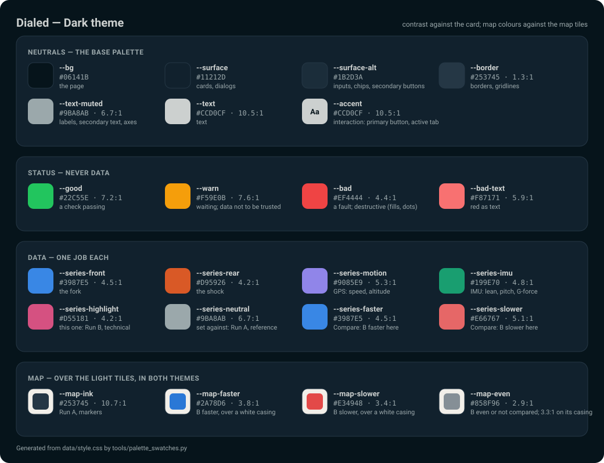
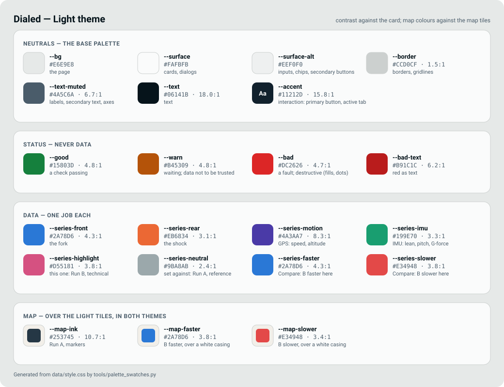

# Dialed — Design system

The rules every page in `web/` follows, so that a new page or chart looks like the rest of the app. **`web/style.css` is the source of truth for every value**: its tokens are at the top of the file, its components in the middle, and the wide-screen layout at the end. This file says what each token and component is *for*, and the rules that go with it. When a value changes, change it in the CSS. This file only needs an edit when a rule changes.

How the pages themselves work (layouts, the run page, the charts' behaviour) is in [dashboard.md](dashboard.md).

## Principles

- **Desktop first.** Tablet, laptop and PC are the target; the phone is a fallback. Check every change at wide widths first.
- **Charts get the height.** The analysis pages are walls of charts: nothing floats over them from 1024px up, and anything pinned has to earn its place (on the run page, only the map does).
- **Colour is data or status, nothing else.** The chrome is neutral. A colour on screen is either a series or a state. The one exception is the logo's lime mark, which belongs to the logo and to nothing else (see [Logo](#logo)).
- **Say what's missing, don't hide it.** A gap in the data is shaded, a value read off a clipped sensor is shown as a floor (`≥11.7G`), a stretch with a lost orientation is greyed out and its values left out.
- **English UI text.** Plain, specific sentences ("0.49 s missing, at 0:00.8"), not codes or jargon.

## Colour

Every colour token of both themes, on that theme's own page and card. The figure after each value is its contrast against the card (the map's colours: against the map tiles).

> [!IMPORTANT]
> The two images are drawn from `web/style.css` by `tools/palette_swatches.py`, never by hand. After a colour change in the CSS, run it again (`~/.platformio/penv/Scripts/python.exe -I tools/palette_swatches.py`) and commit the two SVGs with the change. A new token only shows up once it is added to the script's `GROUPS`.

### Base palette

Six blue-grey steps, the rider's choice (2026-10-25): `#06141B #11212D #253745 #4A5C6A #9BA8AB #CCD0CF`. Every neutral in both themes is one of them or a step between two, marked "between" in `style.css`.

| Token | Job | Dark | Light |
|---|---|---|---|
| `--bg` | the page | `#06141B` | `#E6E9E8` (between) |
| `--surface` | cards, dialogs | `#11212D` | `#FAFBFB` (between) |
| `--surface-alt` | inputs, chips, secondary buttons, skeletons | between `#11212D` and `#253745` | `#EEF0F0` (between) |
| `--border` | borders, gridlines | `#253745` | `#CCD0CF` |
| `--text` | text | `#CCD0CF` | `#06141B` |
| `--text-muted` | labels, secondary text, axis text | `#9BA8AB` | `#4A5C6A` |
| `--accent` / `--accent-text` | interaction: primary buttons, the active tab or nav item, a selected row, the map marker | `#CCD0CF` on `#06141B` | `#11212D` on `#FAFBFB` |
| `--selected-tint` | a selected or hovered row, a neutral badge | | |

**`--accent` is a neutral on purpose.** It used to be a sky blue, one step from the front suspension's blue. With no hue of its own it can't be mistaken for data. It never draws data.

The theme is a device setting (`theme` in `/api/config`), applied by `applyTheme()` in `common.js` as `data-theme` on `<html>`. Each page's `<head>` repeats the last theme seen from `localStorage`, so the first paint is already right. There is no "follow the system" option.

### Status

`--good`, `--warn`, `--bad`, each with an `--on-*` for text on a solid fill. **Red text takes `--bad-text`**, not `--bad` (2026-11-07): `#ef4444` is 4.4:1 on the dark card and 3.8:1 on a secondary button, under the 4.5:1 small text needs; `--bad-text` is at least 5.1:1 on every surface in both themes. Fills, dots and icons keep `--bad`. **Status only**: a check passing or failing, a run missing data, a destructive action, the recording dot. No chart series uses them. (Compare's faster/slower used `--good`/`--bad` until 2026-11-07; it has a diverging pair of its own now, below.) `--warn` (amber) is also the colour of anything the data can't be trusted for, such as the missing-data note and the gap shading.

### Data

| Token | Draws |
|---|---|
| `--series-front` (blue) | the fork |
| `--series-rear` (orange) | the shock |
| `--series-motion` (violet) | what the GPS measures: speed, altitude |
| `--series-imu` (aqua) | what the IMU measures: lean, pitch, G-force |
| `--series-highlight` (pink) | "this one, not that one": Run B in Compare, technical trail segments |
| `--series-neutral` (`#9BA8AB`) | what the highlight is set against: Run A, transition segments, reference traces such as "Vertical" |
| `--series-faster` (blue) / `--series-slower` (red) | Compare's diverging pair: where Run B was faster / slower than Run A |
| `--map-ink` | lines drawn on the map tiles, which are light in both themes |
| `--map-faster` / `--map-slower` | the diverging pair on the map: its light-surface steps in both themes, over a white casing |
| `--map-even` (`#858f96`) | the pair's neutral midpoint on the map: Run B about even, or not compared |

- **Within one chart: front + rear, or one hue + neutral.** Those are the combinations the palette is validated for, colour-blind vision included. Pink ↔ aqua and violet ↔ blue do **not** pass side by side, so never put them in the same chart.

  | In one chart | |
  |---|---|
  | front + rear | ✅ |
  | any one hue + neutral | ✅ |
  | faster + slower (blue + red) | ✅ |
  | pink + aqua | ❌ |
  | violet + blue | ❌ |
  | any other two hues | ❌ not validated |
- Blue, orange and violet have a darker step in the light theme (each clears 3:1 on white). Aqua and pink are the same in both.
- The neutral is only 2.4:1 on the light card, so it always comes with a label ("Run A", "Vertical", the segment names).
- **Text never takes a series colour.** Values, labels and legends stay in `--text` / `--text-muted`; a coloured mark beside them carries the identity (`● Front`, or a badge's `.dot`). In the light theme the rear orange as text was 3.1:1, and the pink "Technical" badge about 3:1 (fixed 2026-11-07).
- **The diverging pair** (2026-11-07) is blue against red, the dataviz skill's own: CVD ΔE 19–22 in both themes. The green/red it replaced was ΔE 7.4 for deuteranopia on the dark card, and no green against red passes. Its blue is the fork's; that is safe only because Compare never draws the fork in its series colour, so don't put the two on one page. It is **always on a solid line**: as translucent fills the two hues fall under the normal-vision floor (ΔE < 8 at 25–35% opacity), so a fill under the line is only a tint. **Its midpoint is a grey** ("about even"): `--text-muted` on the chart, `--map-even` on the map (2026-11-07). Run B's pink there was ΔE 7.8 from the red even in normal vision.
- **A new hue is a palette change**, not a local decision. Validate it with the dataviz palette validator in both themes before using it.
- Page scripts read the tokens once at load (`cssVar()` → `COLOR_FRONT` etc. in `run.js`, `COLOR_BORDER` etc. in `telemetry.js`). Never hard-code a hex in a script.

### The background

The fixed glow behind the glass (`--bg-blobs`) is in the palette's own greys and all cool. A warm one tinted the cards on its side and cost the orange and red data their contrast.

## Logo

"Dial d": a lowercase d whose bowl is an adjuster dial, Fog with a lime mark across its rim, on an Ink tile. Its versions, colours, files and rules are in [brand/README.md](../brand/README.md); this section is what matters for the pages.

| Where | What | Size |
|---|---|---|
| Browser tab, iOS home screen | `favicon.svg`, `favicon.ico`, `apple-touch-icon.png`, linked from every page's `<head>` | |
| Top of the side rail (from 1024px) | `.rail-logo`: `favicon.svg`, a link to the Dashboard | 44px |
| Narrow top bar | none: the page title has the room | |

- **Inside the app it is always the tile** (Ink, the Fog d, the lime mark). It reads on both themes, so nothing switches with `data-theme`.
- **Use the file, don't redraw it**: no copy of the logo in CSS or inline SVG on a page.
- **Lime `#C6F135` is not a token.** It is never a series, a status, a button or a highlight, so it has no place in `style.css`.
- **The icons are made in `brand/`**: `brand/export_all.sh` builds them and copies them into `web/`. Change `brand/` and run it again, never `web/`. A new icon file also needs its own route in `serverInit()`.

## Type

`system-ui` everywhere; no web fonts (the device serves the pages, often with no internet).

| Use | Size | Weight |
|---|---|---|
| Headline figure (`.stat-value`) | 26px, 22px in the run page's stats strip | 700 |
| Page title in the topbar (`h1`) | 18px | 700 |
| Body | the browser's default (16px) | |
| Buttons | 15px | 600 |
| Inputs | 16px (smaller makes iOS zoom in on focus) | |
| Secondary text (`.stat-sub`), field labels, chips | 13px | |
| Labels (`.stat-label`) | 12px, uppercase, 0.05em tracking, muted | |
| Badges | 12px | 600 |
| Chart axis text, the run page's chart-row labels (Avg / Peak / Cursor), suggestion tags | 11px, at every width (a stretched chart works its units out from its width) | |
| Nav and rail labels | 11px and below | |

Figures that update in place use `font-variant-numeric: tabular-nums`, so they don't jitter.

## Shape and space

- **Radius**: `--radius` (14px) for cards; 10px for buttons, inputs and the map; 999px for anything pill-shaped (tabs, nav, badges, floating buttons); 50% for round chips.
- **Spacing**: cards are 16px inside and 12px apart; a field is 16px below the previous one, with its label 6px above it. Pages have a 16px gutter.
- **Touch targets**: 44px minimum height for buttons and inputs (`min-height: 44px`), 40px for the round chips, 34px for icon buttons in a table row.

## Breakpoints

| From | What changes |
|---|---|
| 560px | content up to 640px wide |
| 700px | chart rows put their label beside the chart instead of above it |
| 768px | portrait tablet: the run page's map sits beside its segments (pinned when the window is at least 800px tall) |
| 860px | content up to 1080px; two-column page stacks; Settings in two columns |
| **1024px** | **the wide layout**: the side rail replaces the topbar and the floating nav, nothing floats over the content, the run page pins only its map. Kept at the end of `style.css` so it wins at equal specificity. |
| 1280px | the Runs table's badges sit beside the run's name; below it they go under it, with 6px cell padding |
| 1440px | the Runs table gets its roomier cell padding |

A `1200px` rule capping the run page at 1500px is still in the CSS, but it never applies: the 1024px block comes later in the file and sets 1700px.

## Components

- **Card** (`.card`, almost always `.card.glass`): surface, border, `--radius`, 16px padding. Glass is a frosted blur plus a lit rim in every browser. On Chromium (`html.glass-refract`) the floating chrome also refracts its backdrop through the inline `#glass-refract` SVG filter; cards don't, because over a smooth background there is nothing to bend.
- **Buttons**: the default `button` is the primary one (`--accent` fill). `.ghost` is secondary (`--surface-alt`, bordered). `.danger` is destructive (`--bad` fill), for the moment the action is done: a confirm dialog's button, Stop Run. `.ghost.danger` (red text on a secondary button) is a destructive action sitting among a page's other controls — Delete a profile, Clear IMU Zero, Delete All Runs — so it is never the loudest thing on the card; set a little apart from its neighbours when they share a row. `.link-btn` is an inline text action ("Edit setup"). `.icon-btn` is a square icon in a table row, with a `.danger` tint for delete.
- **Segmented tabs** (`.seg-tabs`): views inside a page (Run: Overview / Analysis / Tuning; Settings: Bike / Sensors / WiFi / System). Labelled, never icon-only, pinned under the top. The active tab takes `--accent`.
- **Navigation**:
  - Below 1024px: a floating pill at the bottom (`.bottom-nav`), with floating action buttons stacked above it on the right (`.fab-stack`, `.fab-btn`, always icon plus label — a `title` tooltip never shows on touch).
  - From 1024px, the **side rail**: a fixed 76px column on the left, top to bottom: back arrow, nav (icon over label), a rule, the page's actions, then the connection and battery chips. It never expands on hover.
  - The lit nav item takes `--accent`.
- **Status chips** (`.conn-indicator`, `.battery-indicator`): 40px round glass chips. Tap for details, since there is no hover on touch.
- **Badges** (`.badge.good / .warn / .bad / .accent`): a pill with a tinted background and the status colour as text. A badge with `data-info` gets an "i" and opens a note on tap.
- **Fields**: label above, 44px input on `--surface-alt`. A dial that doesn't exist on the bike is a **blank** field; 0 is a real setting.
- **Help**: long explanations are collapsed behind `
`.
- **Keyboard focus**: one ring everywhere, `:focus-visible` — 2px `--accent`, 2px out (inside a list row, 2px in, or the list's edge cuts it off). Only keyboard focus shows it. Anything that answers a click and isn't a `<button>` or `<a>` gets `makePressable()` (`common.js`): Tab reaches it, Enter and Space press it. Prefer a real `<button>`, styled to look like what it replaces, as the Runs table's sort headers do.
- **Not by colour alone**: a state shown by a colour also gets a shape or a word — the amber bottomed-out peak in the Runs table has a warning icon in front, the cards say "(bottomed out)". Text a screen reader should hear but nobody needs to see goes in `.sr-only`.
- **Dialogs**: `BikeUI.confirm / prompt / alert / toast` in `common.js`, on a native `<dialog>`. Never the browser's `confirm()` / `prompt()` / `alert()`. A destructive confirm puts the focus on Cancel.
- **Banner** (`.conn-banner`): full-width, under the topbar or beside the rail, `--warn` when the device can't be reached, neutral (`.info`) when the disconnect is expected (recording with WiFi off). It pushes the page down rather than covering it.
- **Recording dot** (`.rec-pulse`): a `--bad` dot with a ring spreading out from it, on the Dashboard while a run records. Steady under reduced motion.
- **Footer** (`.app-footer`): "Dialed © 2026", small and muted, at the end of every page. In the flow, never fixed, so it costs the charts no height; on a page shorter than the window it sits at the bottom, because `<body>` is a flex column at least the window's height and `<main>` takes what is left (`flex: 1 0 auto; width: 100%`).
- **Loading**: skeletons (`body.is-loading`) on the figures and chart areas, which reserve the space the content will take so nothing jumps when it arrives.

## Charts

- **Two kinds of drawing.** Most charts use a 300-unit-wide viewBox stretched to fit, so anything sized in units grows with them: Trends and Compare size their line weights and text from the rendered width and redraw on resize (`rememberChart()`). The run page's time-series stack is drawn in real pixels at its rendered size. Either way, **draw a chart only once its card is visible**; a hidden card measures 0 wide.
- **Marks**: data lines 1.25px with round joins and caps. Gridlines 1px in `--border`, the baseline in `--text-muted`. Histogram bars in the series colour. Points of a scatter are semi-transparent, not a solid heatmap.
- **Axes**: the y axis ends at the data's own lowest and highest values, both labelled, with round gridlines in between, at least 20px apart (a 150px travel row reads 0/20/…/100%, a laptop-height one 0/50/100%). Travel always runs 0–100%. Axis text is `--text-muted`.
- **Hover**: a crosshair and a dot on the line chart; the value is read in the row's "Cursor" figure on the run page (no floating tooltip on a short row), in a tooltip on Trends and Compare. Hit areas are larger than the marks.
- **Missing and untrusted data**: a gap in the samples is shaded `--warn` at 0.35 under the traces (never thinner than 2px), and the line breaks there instead of being drawn straight across. A stretch with a lost orientation is shaded `--series-neutral` at 0.22, and its lean, pitch and vertical G are not drawn. A peak read off a clipped sensor is written `≥`.
- **Legends**: two or more series always have one, in the chart's own card (Compare repeats Run A / Run B under each chart); the run page's "Cursor" lines double as it. One series needs none, since the chart's title names it.
- **Reduce without losing peaks**: long series are cut to 400 buckets keeping each bucket's minimum and maximum (`minMaxPoints()`), all of one chart's series together, so a peak is never dropped and a cursor reads every series at the same instant.

## Motion

Short and functional: 0.15s on tab and nav state changes, the skeleton sweep while loading, the recording dot. **Every animation has a `prefers-reduced-motion` fallback**; the loop animations stop, and the state is still shown without them.
