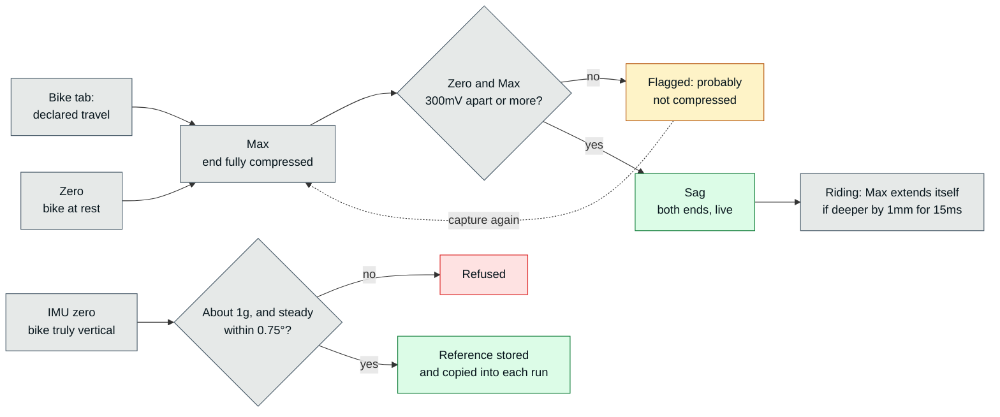

# Dialed — Hardware

The bike, the pins, the sensors and how they are calibrated, and how the IMU is mounted and read.

## The bike

**Bike**: Propain Tyee 5 29 (full suspension).
**Front suspension**: RockShox Domain — 170mm, Motion Control RC damper. Only **LSC + rebound are adjustable**; HSC is fixed at the factory (shim stack), there is no dial. DebonAir with up to 3 volume tokens.
**Rear suspension**: RockShox Super Deluxe Select+ C1 — 55mm actual stroke (shock stroke), ≈160mm wheel-equivalent (leverage ratio ~2.9:1). RCT damper: **adjustable rebound (10-15 clicks) + Open/Threshold lever**, no graduated compression (LSC/HSC) at all. Full spec in the rear-shock section.

## Pins

| Module | Bus / pins | Notes |
|---|---|---|
| Suspension sensors (KPM12J, 200mm front / 75mm rear) | ADC1 — front GPIO32, rear GPIO33 | 11dB attenuation, calibrated mV through `fast_adc` (same values as `analogReadMilliVolts()`), 4× oversample |
| IMU (BNO08x) | own HSPI bus — SCK 27, MISO 35, MOSI 13, CS 26, INT 39, RST 25 | **400kHz**; INT has an external 10kΩ pull-up (GPIO39 has no internal pull) |
| SD card | VSPI — SCK 18, MISO 19, MOSI 23, CS 5 | **20MHz** (10MHz until 2026-10-07 — do not lower it, see [sd-card.md](sd-card.md)), FAT32 with 64KB clusters |
| GPS | UART — RX 16, TX 17 | |
| Battery voltage | ADC1 — GPIO34 | single cell, 3000mAh, about 9¾h a charge ([Battery](#battery)); shown as percent by `batteryPercent()` from the voltage |
| LED (WS2812B) | GPIO22 | |
| Button | GPIO4 | 10s long-press resets connectivity to defaults |

GPIO36 is free (it briefly held the 3.3V rail monitor). Any future analog input must be on ADC1 — ADC2 is unusable while Wi-Fi runs.

## Battery

**A full charge lasts about 9¾ hours** on a riding-day cadence (bench, 2026-10-27/28): from 4.19V at 18:19 to the last answer at 04:04, 2.68V. That is more than twice the rider's 4-hour estimate, so a day of riding is covered with room to spare. Measured with `tools/bench/battery_drain.py`: a 2-minute timed run every 12 minutes with the radio off (a descent), the home network in between, the voltage read from `/api/status` every 30s. 47 runs were recorded on the way.

- **Average current ≈ 310mA**: 3000mAh over 9.74h, if the cell still gives its rated capacity. A worn cell gives less, so the real figure is that or lower. There is no current meter, so this is the only figure.
- **The voltage rises while recording** (+0.04V over each 2-minute run) and drops again once WiFi is back. The radio is the biggest single load.
- **Below 3.3V it falls off a cliff**: 3.33V → 3.26V → 3.11V → 2.72V in the last four 12-minute steps. Nothing went wrong on the way down: no reboot (the uptime counted on throughout), the free heap steady (84KB with WiFi on, 61KB while recording), every run whole down to 3.11V. The single exception is in [sd-card.md](sd-card.md#spill-buffer-2026-10-26).

> [!IMPORTANT]
> **The percentage is pessimistic near the bottom.** `batteryPercent()` maps the voltage, and on this cell it reaches 0% at 3.31V, 33 minutes before the device stopped. The LED's low-battery warning comes on below 20% (3.6V), with about 2¾ hours still left.

> [!WARNING]
> **The device runs the cell down to ~2.7V.** It has no cutoff of its own. That is lower than a Li-ion cell should go often. Charge it after a long day, and don't leave it switched on in a bag.

The discharge curve and what the percent said (bench, 2026-10-27/28)

Readings with WiFi on, between runs. "Left" is the time until the device stopped answering (584.6 min after the start).

| Elapsed | Voltage | Percent shown | Left |
|---|---|---|---|
| 0h | 4.19V | 99% | 9h45 |
| 1h | 4.05V | 89% | 8h45 |
| 2h | 3.99V | 83% | 7h45 |
| 3h | 3.93V | 73% | 6h45 |
| 4h | 3.85V | 60% | 5h45 |
| 4h52 | 3.80V | 50% | 4h52 |
| 6h17 | 3.70V | 30% | 3h27 |
| 6h57 | 3.60V | 20% | 2h48 |
| 7h46 | 3.50V | 10% | 1h59 |
| 9h12 | 3.31V | 0% | 0h33 |
| 9h45 | 2.68V | 0% | — |

**How close this is to a ride:**
- Indoors the GPS keeps searching for a fix (it had one some of the time), and on the trail the radio is the device's own access point, not a client of the home network. Both change the draw by an amount that was not measured.
- There is no vibration and the LED is not on a bike. The cadence matches the 2026-10-25 ride.
- The device had been on USB, charging, for about six hours before the start. It was unplugged at 4.19V.

## Suspension sensors and calibration

Max can't be captured until that end's declared travel is set in the Bike tab. Zero and Max are per end and belong to the device, not to a bike profile; the sag goes stale when the pressure or tokens change.

- **Sensor strokes**: 200mm KPM12J on the 170mm fork, 75mm KPM12J on the 55mm shock, so neither sensor runs out of rod before the suspension bottoms.
- **Two-point calibration per side**: Capture Zero (rest) and Capture Max, stored in millivolts in NVS (`suspension` namespace). It is device-level and **not part of a bike profile** — it describes how the sensor is mounted right now.
- **Declared travel** (`settings.frontMaxTravelMM` / `rearStrokeMM`) is a separate, rider-entered spec that lives in `SystemConfig` and in each bike profile (`bikes.cpp`), so switching bikes restores the right travel. `run.html` reads it from each run's `.JSON`.
- **The active bike's profile keeps itself up to date** (2026-10-07, the rider's call: having to remember to click a button is halfway to it being inconsistent). The active bike is the profile saved under `settings.bikeName`, when there is one, and `BikeProfiles::syncActive()` rewrites it from the live settings after everything that changes a field a profile holds: every `POST /api/config`, Set Travel, Capture Max and Capture Sag. Before, only "Save As" wrote it, so it was stale after any edit and activating it brought old values back. What follows from the name being the profile's key:
  - **A new bike name renames the profile** (in the config handler), instead of leaving it behind under the old name. Refused with a 409 — shown in the card's status line — when the name is empty or is another profile's.
  - **"Save As…" switches to the new profile.** Otherwise a copy saved to try something different would be the one left untouched while the original changed. The page asks before replacing an existing profile.
  - `BikeProfiles::rename()` refuses to land on another bike's profile (it used to overwrite it silently), and no longer deletes the file when both names are the same file — FAT ignores case and `pathFor()` folds punctuation, so "tyee 5" → "Tyee 5" was write-then-delete of one file.
  - `GET /api/bikes/profile?name=` returns a saved profile as it is on the card. Nothing could read one back before.
  - With no profile under the bike's name (fresh device), nothing is written and the list says "(current setup — not saved as a profile)"; the first profile is still created by "Save As…".
  - `activate()` reads values back at the precision the profile stores (sag and travel to 0.1, pressure to 1 psi), which is also the precision everything else prints them at.
  - Checked on the device through the API (18 checks, 2026-10-07), with the config, the Tyee 5 profile and the profile list byte-identical afterwards. Driven from the page's own buttons by the rider since (confirmed 2026-10-11).
- The max calibration point auto-extends if a deeper compression is seen, but only when it beats the old max by more than 1mm for 15ms continuously (a sample-count gate once corrupted a calibration at high sample rates). The declared mm never drifts.
- **The rear is calibrated directly in shock-stroke mm (55mm)**, not wheel travel — no leverage-curve conversion. `rearWheelTravelMM` is informational only.
- Logged travel is the unsmoothed instantaneous reading; the EMA-filtered value is only for the live display.
- The rear sensor was bench-verified linear (~44mV/mm, 6-point ruler sweep). Its first bracket made the rod under-track the shock (22% sag shown against a real 30%); a redesigned bracket fixed it. **Verify bracket geometry against a known physical mark before trusting a calibration**, especially on the short rear stroke.
- **Static sag**: the "Sag" step in Settings → Sensors captures both ends from the live sensors (`/api/suspension/sag/capture`). It goes stale when pressure or tokens change; the setup history flags that (see "Setup-change history" in [dashboard.md](dashboard.md#setup-change-history-2026-10-08--on-the-device-checked-against-run004246-no-run-with-changed-clicks-or-pressure-yet)).
- **Calibration UI**: Settings → Sensors walks through it as Zero → Max per end, then Sag, with a live reading per end, a ✓ on each finished step and the outcome of every capture shown next to its button. A Zero and Max less than 300mV apart are flagged as probably not compressed (`CAL_MIN_SPAN_MV`; the real calibrations span ~2300-2900mV). Capture Max is disabled until that end's declared travel is set in the Bike tab.

## IMU orientation — lean, pitch and vertical G

**Units**: `pitch`/`roll` come in **radians** from the BNO08x library, and the firmware, the `.CSV`, the `.CSVB` and the run `.JSON` all carry radians (`max_lean_deg`/`max_pitch_deg` are misleadingly named). The dashboard converts at the two points where raw values enter it (`parseCompactTelemetry()` in `telemetry.js` and `statsFromMeta()` in `run.html`, via `RAD_TO_DEG`). Logged precision is 0.01 rad (≈0.57°). `ax/ay/az` are **raw body-frame**, not gravity-compensated.

**Mounting**: IMU axes are x forward, y left, z up. On the bike the master sits inside the frame triangle with its **x axis ≈64° above horizontal** (rest pitch −64.2° in every test; pure pitch, rigid and repeatable). Rest roll is not a mount constant — it varied −2° to −14° with how straight the bike was held.

**Why raw Euler angles are not bike lean/pitch**: with x that steep, roll rotates about a near-vertical axis, so real lean shows up amplified and mixed with yaw (5° true lean → ≈11° roll swing, 20° → ≈40°, 45° → ≈66°). Subtracting an offset does not fix it; a rotation does.

**"Zero IMU" — implemented and field-validated (2026-09-26)**. After zeroing with the bike vertical, the live lean/pitch readout in Settings matched real tilts in sign and magnitude.
- Reference = unit gravity-up vector in sensor axes, derived from the rotation vector's own Euler angles (yaw drops out, so the yaw-less `.CSVB` is fine). Stored in `settings.imuUpX/Y/Z` (NVS) — **device-level, not in bike profiles**, like the suspension calibration. Every run's `.JSON` gets its own copy as `imu_up`, so old runs are never re-interpreted.
- Maths: `up = norm(a_rest)`, `fwd = norm(x − (x·up)up)`, `left = up × fwd`, `M = [fwd left up]`, `R_bike = R_euler(t)·M`; lean/pitch are the Euler roll/pitch of `R_bike`. Quantisation error ≤ 0.4°.
- Firmware: `imuMeasureRest()` (averages ~1.5s; rejects if |a| isn't ≈1g or the direction wobbles >0.75°), `imuBikeAngles()`; endpoints `GET /api/imu`, `POST /api/imu/zero` (409 while recording), `POST /api/imu/clear`.
- Settings → Sensors: "IMU Orientation" card with a Zero button and a live lean/pitch readout.
- Dashboard (`telemetry.js`): `bikeBasis()`/`bikeAngles()` applied in `parseCompactTelemetry(buffer, basis)`. Lean is + to the right, pitch is + nose up.
- **Operating notes**: zero with the bike **truly vertical** (wall/stand + level) — a reference taken with the bike held differently biases lean by ~5°. Re-zero whenever the master is re-mounted or moved to another bike. Runs recorded before zeroing (no `imu_up`) show raw sensor angles with an amber note and can't be corrected retroactively.

**The IMU's orientation is not always right (found 2026-10-16).** RUN0049's lean chart jumps between +180° and −180° from 0:55 to 0:58 and its pitch reaches 82°, at 21–25 km/h. The dashboard's maths is not the cause: the raw roll wrapping from −π to +π is harmless to it (`gravityUpInSensorAxes()` goes through sine and cosine). What is wrong is the orientation the BNO08x itself reports: for several seconds it has pitch ≈ 0 and roll ≈ ±180°, a sensor lying upside down, while the bike is being ridden.
- **Measured across the field runs** by setting the sensor's "up" (from its pitch and roll) against the accelerometer averaged over one second. They normally differ by 15–22° (the median), the average accelerometer being pulled off vertical by braking and cornering. In stretches they differ by much more: RUN0049 by up to 146° from 53.5 to 60.7s, and over 45° in nine other stretches; RUN0047 up to 67° (74.8–77.9s); RUN0050 up to 65°; RUN0046 and RUN0048 a few short stretches near 45–54°.
- **What it spoils there**: lean and pitch, and the **vertical G**, which uses the same "up" — so the harsh events and the G-force chart's vertical trace too. Combined G (the magnitude) does not depend on it.
- **The accelerometer saturates at ±8g** (±78.7 m/s² on x, ±78.6 on z): dozens of samples sit exactly at the ceiling in every field run, 47 on x in RUN0049, the run with the worst orientation. It is the likeliest reason the fusion loses track — it is fed readings that are cut off — though not proven; the gyro, which is not logged, may be saturating too. It also means **every peak G above about 8g on one axis is a floor, not a measurement** — the "11.7G" peaks are what is left when two axes are clipped.
- The reports in use: `enableRotationVector()` (accelerometer, gyro and magnetometer) and `enableAccelerometer()`, both every 10ms.
- **Softening the master's mount was turned down** by the rider (2026-10-16): not the way to go.

**What was done about it (2026-10-16):**
- **The run page stops showing what it cannot trust.** `findOrientationLoss()` (`telemetry.js`, run inside `parseCompactTelemetry()`) compares the two "ups" row by row; a stretch where they differ by more than 60° is lost, extended on both sides while they still differ by more than 35°. There lean, pitch and vertical G are set to null: the charts break their line and shade the stretch grey (lean, pitch, G-force), the peaks and the lean histogram leave it out, and so do the harsh events. A line under the setup says "Orientation lost for 23 s in 6 stretches — lean, pitch and vertical G are not shown there". On the field runs: RUN0049 23s in 6 stretches (its peak lean went from 180° to 47°), RUN0047 6.7s, RUN0042 1.9s, RUN0050 1.0s, RUN0046 and RUN0048 none. The thresholds are a first estimate: a pitch peak of 57–59° survives on RUN0049 and RUN0050, which is more than a bike's.
- **Peaks of G read off a clipped reading are shown as a floor**: "≥11.7G" for the G-force peak (chart and histogram) and in the Notable Events' bottom-out and jump labels (`accelClipped()`, `formatPeakG()`). Nearly every field run has one. The trail segments' "peak" too, and the Tuning tab's bottoming-out advice reads "impacts of at least 11.7G this ride — past what the sensor reads" instead of "up to" (added 2026-10-19).
- **The device records what would tell why** (`imuDiagStart()`/`imuDiagToJson()` in `imu.cpp`): every run's `.JSON` gets `imu_diag` — for each second, the worst accuracy status the rotation vector gave itself (`status`, 0 unreliable … 3 high), its largest accuracy estimate in degrees (`accuracy_deg`), and how many accelerometer reports had an axis at the ceiling (`accel_clipped`). Up to 15 minutes. No new report is asked of the sensor — both come with the reports already in use. On the bench: status 3, 5–7°, nothing clipped. Whether the status moves when the orientation goes wrong is what the next ride will say; the library documents that estimate as one of heading, so it may not.

**World-frame vertical G (done 2026-10-03)** — `verticalG()` in `telemetry.js`: vertical acceleration in g with gravity removed, + for an upward push (compression, landing), − for unloading toward freefall.
- **It needs no bike basis and no `imu_up`**, so it works on every run, including those recorded before the IMU was zeroed. World-up in sensor axes comes straight from the row's own pitch/roll (`gravityUpInSensorAxes()`, shared with `bikeAngles()`); yaw drops out because rotating about the vertical axis can't change a vertical component.
- Validated on RUN0041 (device stationary, gravity split across axes at ax 2.27 / az −9.55): median **0.0007g**, spread ±0.02g.
- Accuracy limits: the 0.01 rad quantisation gives ~0.01g error at rest and ~0.1g at a 10g peak, and the BNO08x's fused gravity estimate can lag during a sustained high-g hit.
- On real trail data (the 4 field runs): median −0.04 to −0.51g, max 8.5-9.9g, min −6.6 to −9.0g. The slightly negative median is expected, not a bias — terrain unloads the bike often and in small amounts, then loads it sharply and rarely.
