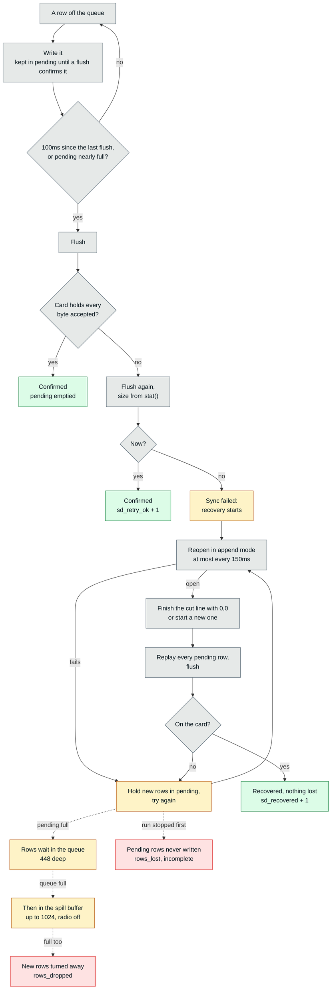

# Dialed — SD card write path

How a run gets onto the card, why writes failed and how that was fixed, and what was ruled out on the way.

> [!NOTE]
> **In short**
> - Runs used to "fail" to write because the SD driver took a stray `0x03` in the card's status for an error. A project copy of the driver (`lib/SD`) asks again before failing (2026-10-11); the first ride on it had no failure at all.
> - A write that does fail is still recovered: the file is reopened and the rows since the last good flush are replayed, so nothing is lost.
> - A card that merely stalls is covered for ~2.6–2.8s: the 448-row queue, then a spill buffer of up to 1024 rows that each run takes from the heap the radio frees (since 2026-10-26). One stall of ~3.8s has been seen past it, in 47 bench runs.
> - Hundreds of runs on the card are fine: nothing walks the card by opening every file any more (tested with 120).
> - Reading a run's integrity: see [How to read a run](#how-to-read-a-run).

> [!WARNING]
> **Never lower the SD clock** (`SD_SPI_HZ`, 20MHz). The failures follow how long the bus is busy, so a slower clock is worse. See [Ruled out or tried](#ruled-out-or-tried).

> [!CAUTION]
> Bike profiles live on the card at `/bikes/*.json` — a format destroys them, back them up first.

## Current state

**The cause of the sync failures was found and fixed in a project copy of the SD driver (2026-10-11), and the first ride on it had no failure at all** (2026-10-18: 3 runs, `sd_recovered` 0 in each — see that field test in [field-log.md](field-log.md#field-test-2026-10-18-the-new-firmware-on-a-ride)). Before that: 0-3 failures a run, all absorbed, at 385Hz and 10MHz (2026-09-28); 0-11 a run at 500Hz and 20MHz, two of four runs losing half a second each (2026-10-10).

## What the failures are (found 2026-10-11)

Not a failed write. After every write the framework's SD driver asks the card for its status (CMD13) and fails the write unless the answer is zero. On this card the answer now and then contains a stray `0x03` — as the second status byte, or as the first, where the driver logs it as `token error [13] 0x3` — after a write whose every data block the card had accepted, CRC included. The driver returns an error, FatFS latches it on the open file, and from there on it is the "failed sync" that `run_service.cpp` recovers from by reopening the file and replaying the rows.

**The fix**: `sdWriteStatusOk()` in `lib/SD/src/sd_diskio.cpp` asks for the status again (up to four times) and only fails the write if the card repeats itself. `0x03` is not one of that byte's error bits (0x04 error, 0x08 CC error, 0x10 card ECC failed), and its bit 0, "card is locked", cannot be true of a card nothing ever locked. On every occurrence so far the second answer was clean.

> [!IMPORTANT]
> `lib/SD` is the framework's SD library 2.0.0 with those changes marked `PROJECT CHANGE (Dialed)`; PlatformIO picks it over the framework's own. It has to be re-derived if the platform is ever moved to a newer core.

How it was found, what was measured, and what is still unexplained

- **How it was found.** The field failures of 2026-10-10 line up with the file growing into a new 64KB cluster: of 32 failures (field and bench), 19 fall within 8KB of a cluster boundary, where chance would put 8 — and the first two clusters of a new file are the worst, which is the "first second and a half". Short timed runs on the bench reproduce it (about one start in four). None of those failures left a line in the driver's log, because the paths they take are silent upstream; a copy of the driver with log lines on them (`lib/SD`) showed `status r1 0x0 r2 0x3` on every one, and no data-token or CRC error on any.
- **Measured** (bench, bike still, WiFi off, 500Hz, 20MHz): before, 16 runs of 4s gave 4 recoveries and one run that lost its last 1.3s; after, 30 runs of 4s and 3 of 100s gave **no recovery at all**, with 10 stray statuses absorbed (7 of them in one run, 6 inside its first 2 seconds — what used to be a long outage). Every line of every file checked against the row format and the 2ms spacing.
- **Why the first clusters of a file, and why `0x03`**: not established. It reads like the tail of the card's busy signal being taken for a status byte (the line low, then released), which would fit the driver deselecting the card straight after the stop token; it was not put on a scope.
- **Still genuine, and still there**: command-phase bit errors on the link (`sdCommand(): crc error`), which the driver retries by itself — two in 100s on the bench. Those are what "rate ∝ time the bus is busy" was measuring on 2026-10-07, along with the stray status.
- **Upstream also never retries a data block the card rejects**: it compares the data response token with `0x0A` and `0x0C`, and a card answers `0x0B` (CRC error) or `0x0D` (write error). Left as it is — no such token has been seen — but it is where to look if `data token` lines ever appear in the log.

## Buffers (rebalanced 2026-10-11)

The writer used to keep taking rows off the queue while the card was away, into a `pending` buffer that was already full — which is how RUN0049 and RUN0050 lost rows with the queue empty. It now leaves them in the queue once `pending` is full. With that, `pending` no longer has to cover an outage alone, so it went from 384 rows to 192 and the queue from 256 to 448: the same 40KB, 1.28s of cover for a recovery (it was 0.77s), and 0.9s for a writer that is merely slow (it was 0.51s — with the driver fixed, a bench run still dropped 24 rows when the card took 290ms and then 357ms over two writes in a row, with nothing wrong). The card does that at the start of a file and about every megabyte.

Flushing before `pending` fills, and the bench results

- **`pending` is now also flushed when it is about to fill**, not only by the clock. Rows that queue up behind a slow write are written in one burst, far more than a flush window, and with the queue deeper than `pending` that burst overflowed it: three 100s bench runs came back `incomplete` with every one of their 50000 rows in the file. A flush confirms the rows and empties `pending`, so outside a recovery it can no longer overflow.
- **The firmware as it now is, on the bench**: 11 runs of 4s and 3 of 100s, no recovery, nothing dropped, nothing lost, every line valid. Not ridden.

## Spill buffer (2026-10-26)

On 2026-10-25 the card stopped for 1.36s over three writes in RUN0057, no write failing, and 151 rows were dropped: the queue covers 0.9s. The queue can't simply be deeper — it comes from the heap WiFi needs, at boot. But with the radio off for a run (`wifiOffWhileRecording`, the default), the WiFi driver's memory is free, so **each run takes a second buffer behind the queue and gives it back before the radio comes up again** (`spillTake()` / `spillGiveBack()` in `run_service.cpp`).

- **Rows go into it only once the queue is full**, and every row after that goes into it too until it is empty again. The writer takes from the queue first and from the spill only when the queue is empty, so it sees every row in the order it was sampled. One producer (`log()`, core 1), one consumer (the writer, core 0): a ring with an atomic index each side, no lock.
- **stop()'s drain marker** can reach the queue while the spill still holds older rows; the writer holds it back until the spill is empty (`takeRow()`).
- **Taken in 4KB chunks**, up to 16 (1024 rows, 2s at 500Hz), while the free heap stays above 32KB. With the radio off there is ~100KB free but in pieces: as one block the spill got 223–383 rows and shrank from run to run on the bench; in 8KB chunks 640–896; in 4KB chunks 832–960, and the full 1024 on a fresh boot.
- **None with the radio on** — that heap is lwIP's. A run recorded with WiFi on has `spill_rows: 0` and the queue alone, as before.
- Each run's `.JSON` says what it had: `spill_rows`, `spill_max` (the most it held at once) and `heap_free_recording` (free heap once it was taken).

**A real stall longer than it covers, once** (battery drain test, 2026-10-28, bench). Of 47 two-minute runs, 44 never touched the spill. Three in a row, at 3.47–3.43V, did: it held 258 rows, then 304, then filled (960 rows) and **495 rows were dropped**. That is a card stall of about 3.8s (448 queue + 960 spill + 495 dropped rows at 500 a second). No write failed (`sd_recovered` 0), so the card was slow, not wrong. It is not simply the low battery: the seven runs after it were clean all the way down to 3.11V. The card had also been written and emptied 44 times in a row by then (~6MB a run), which may matter just as much. The runs were deleted by the test before their `write_us` could be read, and the script now keeps the CSV of any run that touched the spill.

How it was tested (bench, 2026-10-26)

A temporary hook made the writer stop for a set time partway through a timed run — a card stall to order — and every line of each file was checked for the 2ms step and the order. Since removed.

| Stall | Spill | Rows dropped | |
|---|---|---|---|
| 1.5s, as RUN0057 | 960 / 832 rows | 0 | ✅ |
| 2.5s | 896 | 0 | ✅ |
| run stopped 1.5s into a 2.5s stall | 832 | 0, every row to the last | ✅ |
| 4s (8KB chunks) | 640 | 1074, in one gap, the rest in order | ✅ as expected |

The heap's largest free block was 45KB after each run, as before it: giving the chunks back leaves WiFi no worse off. A normal 10s run on the final build: spill 1024 rows, unused, 5000 rows 2ms apart.

## How to read a run

> [!TIP]
> Check **`rows_dropped`** in the `.JSON` first — it is the only number that means samples were lost at the queue (`incomplete` does not cover it). `incomplete` means rows were lost on the card side — believe it even when the charts look whole, a hole of half a second does not show in a 97s run. `sd_recovered` > 0 just means the card hiccuped and the firmware caught it.

## What a run is missing (2026-10-16)

Shown as an amount, not as "Incomplete" — half a second gone from a 97s ride is not a run cut short.

- **Run page**: an amber line under the headline figures (under the setup until 2026-10-25), from the gaps in the samples themselves (`findGaps()` in `telemetry.js`: a step more than 2.5 times the run's usual one) — "0.49 s missing, at 0:00.8", or "0.75 s missing in 3 gaps: 0:00.4 (0.70 s), 0:21.1 (0.02 s), 1:28.8 (0.03 s)". It works for every run, and it found holes nothing had flagged: 0.75s in RUN0042 and 0.12s in RUN0046, recorded before 2026-10-07 — mostly the hole at the start from when the WiFi went down half a second into a run, and the rows each recovery used to lose. A line left short by a recovery is not a gap: the `.CSVB` conversion (`parseCsvLine()`) needs only the first 15 columns and reads it like any other. **The gaps are also shaded on every time chart** (the warning colour, under the traces, never thinner than 2px), since a trace drawn straight across one is not data.
- **Runs list**: one badge, "0.49 s missing", from the counts in the run's `.JSON` (`runMissingSeconds()` in `common.js`: `rows_lost` and `rows_dropped` against all the samples taken over the duration). It replaces both "Incomplete" and "Rows dropped". A run recorded before `rows_lost` was counted and flagged incomplete (RUN0049, RUN0050) still says "Incomplete", and its explanation points to the run's page; the list entry now carries `rows_written` and, when the run has it, `rows_lost`.
- A run with gaps but no flag (RUN0042, RUN0046) has no badge in the list — the list only knows what was counted — and shows them on its own page.

**New in the run's `.JSON`**: `rows_lost` (rows the writer took and never got onto the card; `rows_written` now subtracts them), `sd_recover_max_ms`, and how many recovery attempts failed at each step (`sd_reopen_failed`, `sd_stat_failed`, `sd_replay_failed`).

### A recovery no longer leaves a line short (2026-10-16)

The last good flush always lands mid-row (it is taken right after a row's first 15 columns), so the row's `write_us,flush_us` were in the buffer a failed sync lost, and that line stayed two columns short with the replay starting on a new one. `tryRecover()` now finishes it with the `0,0` every replayed row gets — when the card holds exactly what that flush left (`confirmedBytes`, `confirmedMidRow`); otherwise the replay starts on a line of its own as before. It also no longer adds an empty line when the failure comes before the first data flush (by the same check; that case was not among the ones tested).

How it was checked

Checked with a test build that faked a failure every 37 flushes and cut the file back to what the last good flush had left, as a real failure does: 4 recoveries in a 20s bench run, 10000 lines, every one well formed, every step 2ms, no duplicate. The test code is not in the firmware.

## Recovery mechanism

In `src/run/run_service.cpp`:

Amber is waiting, red is data lost. The counters a failed step leaves (`sd_reopen_failed`, `sd_stat_failed`, `sd_replay_failed`) are in the run's `.JSON`.

1. After every flush (every 100ms, `RUN_FLUSH_INTERVAL_MS`), compare the on-disk size with the bytes accepted. The size comes from `stat()` on the file path — **not** `csvFile.size()`, which returns a stale cached value when called twice with only a `flush()` in between. That bug made `sd_retry_ok` structurally 0 in every run before the fix; ignore those old readings and any conclusion drawn from them.
2. On mismatch, retry the flush once (`sd_retry_ok`).
3. If it still fails: reopen in append mode, write a newline, and **replay the `pending` buffer** — every row since the last confirmed flush (`sd_recovered`). Reopen is retried every 150ms; a final attempt runs at `stop()`.
4. `pending` is 192 rows on the heap (384 until 2026-10-11 — see [Buffers](#buffers-rebalanced-2026-10-11)), allocated once at boot. If it overflows, the run is flagged `incomplete` and the LED goes red. Recovered failures raise neither.
5. **A recovery now costs no rows at all** (fixed 2026-10-07). `RunService::log()` used to refuse a row when `csvFile` was invalid — and the writer task closes and reopens that very handle during a recovery, so every row sampled in those few milliseconds was discarded before the queue and counted nowhere: 1 to 20 rows per recovery, in every run that ever had one (these are the "37-44ms holes" noted in September). `log()` now only looks at the recording state. Checked on a run with a recovery in it: 30001 rows sampled, 30001 in the file, every one 2ms after the one before. The row the failed flush landed on keeps its 15 data columns and loses only its two diagnostic ones, which the dashboard's parser does not need.
6. Run `.JSON` counters: `sd_retry_ok`, `sd_recovered`, `sd_last_errno`, `sd_last_gap_bytes`, `rows_dropped`, `rows_written`. To check a run for rows lost anywhere, compare the rows the loop profiler counted (`/api/debug/loop` → `last_recording.rows`) with `rows_written` — that comparison is what exposed item 5.

## Too many runs on the card (found and fixed 2026-10-11)

The bench test left 104 runs on the card. Starting a run then took long enough for the 8s task watchdog to reset the device (`nextRunNumber()` opens every file in the root directory, and is called twice per start from the dashboard), and asking for the runs list reset it every time (`RunService::list()` reads every run's `.JSON` inside one request; one reset was a watchdog, one a panic, most likely out of memory). Deleting the test runs one by one — `DELETE /api/runs` does not list — brought it back; the rider's eight runs were untouched. Where the limit was, was not measured: somewhere under 100 runs.

**Fixed the same day — measured with 120 runs on the card, no reset.** Three things were wrong, and each had to go:

The three fixes, what a page costs, and the runs list kept in the browser

- **Walking the directory by opening every file.** `File::openNextFile()` opens each entry, and on FAT opening a file means searching the directory for it, so listing N files read the directory N times. Everything that walks the card now goes through `rootFileNames()` (`run_service.cpp`), which reads names and nothing else: finding the next run number takes about 0.1s whatever the card holds (the request that starts a run: 61ms with 9 runs, 102ms with 118). Orphan recovery at boot looks for each `.JSON` in those names instead of on the card.
- **Every run in one reply.** `GET /api/runs` is paged: `{ total, offset, runs }`, newest first, `offset` and `limit` (25 by default, 50 at most), the watchdog fed after each run.
- **The reply built whole in memory.** The first paged version still assembled its 16KB (25 runs with their setups) as one document and one string, and that left the WiFi stack too little memory to send it: replies took 10–40s and the watchdog fired anyway. It is now sent a run at a time (chunked), and the lowest free heap during a page went from 46KB to 73KB.
- **What a page costs**, 25 runs with their setups, with 120 runs on the card: 2.5s for the newest, 1.1s for the oldest — against 0.4s with 9 runs. Opening a file still takes longer the further down the directory it is, and the newest runs are the furthest. All 120 take 9.4s to read — which is why the dashboard stopped reading them all every time (next point but one).
- **Dashboard**: `fetchRunsPage()`, `fetchAllRuns()` and `fetchRunsCount()` in `common.js`. The Runs page asks only for the page it shows (25 runs; pager above the list with Previous, the page numbers and Next — the rider's choice over "Newer / Older" — the page and the sort order kept in the address — `#p3`, or `#p2-duration-desc` — so that the browser's Back from a run returns to them; the same string is left in `sessionStorage` and `common.js` adds it to the topbar's back arrow on the run, Compare and Trends pages, which is a plain link to `/runs` and at first went back to page 1 (found by the rider, 2026-10-13)); sorting by anything but newest-first loads the rest first, once. Compare, Trends, the run page's setup history and the count before "Delete all" go through the same two functions.
- Checked on the device with 120 runs: pages 1, 3 and 5 and an out-of-range one, the run page's history line, then Runs, Trends and Compare again with the card back at 8 runs. The clicks — the pager, sorting across pages, the back arrow, "Delete N" — were the rider's, on 2026-10-13.
- **The browser keeps what it has read of each run (2026-10-13)**, so the pages that need every run (the setup history on the run page, Trends, the Compare pickers) stop reading them all on every visit. `GET /api/runs?index=1` gives every run's name and a **stamp** — the size, modification date and modification time of its `.JSON`, as the card's directory has them — without opening a file: one pass with FatFS's own `f_readdir()` (`RunService::stamps()`), which is where a directory entry's size and times are; the Arduino File API and `readdir()` give the name only. `common.js` keeps each run's entry in `localStorage` with the stamp it was read with, and asks the device by name (`?names=…`, 25 at a time) only for runs it does not have or whose stamp has changed.
  - **Why a stamp per run and not a counter on the device** (the first plan): a counter has to be bumped by every code path that changes a run, misses a card edited on a computer, and one edit throws away everything kept. The stamp comes from the card itself, so it also catches a run deleted and recorded again under the same name — the rider's question — whichever way that happened.
  - **It does not need the clock**: with the time never set the date is 1980-01-01, but the time of day still runs from power-up, so two writes of a file land on different stamps. What would slip through is the same `.JSON` rewritten to the same size within the same two seconds.
  - What is kept is dropped when the firmware version changes (the index carries it), since what an entry holds can change with the firmware. A run with no `.JSON` yet has no stamp and is read every time. Without `localStorage` nothing is kept and every run is read every time.
  - **Measured with 38 runs on the card**: the index 0.11s; nothing changed since the last visit, 0.11s in all; one run new or edited, 0.23s; nothing kept yet, 2.2s (it was 2.2s every time). The logic was run against a simulated device through each case — cold, warm, a run edited, three new, one deleted, the same name recorded again, no stamp, new firmware, no storage.
  - The page form of the endpoint (`offset`/`limit`) is still there; the dashboard no longer uses it.
  - **Tested by the rider in real browsers on 2026-10-16**, laptop and phone, watching which runs the browser asked for: the cases above, plus an edit made on one device reaching the other.

## How it got here

Earlier stages of the investigation, kept because their measurements are still the reference.

What was wrong, in order of how much it mattered (2026-09)

1. **`printf("%.2f")` float formatting — the biggest win, and not the card at all** (found 2026-09-26). Varargs promote each float to double, the ESP32 has no double-precision hardware, and newlib's `dtoa` is software emulation: RUN0040 measured a **median 2082µs to format one row's 12 floats** (~89% of a core). The writer could not keep up and 3077 of 11754 samples (26%) were dropped at the queue, mostly thinning the stream rather than leaving visible holes. Replaced with hand-built integer formatting (`appendU32`/`appendFixed`, byte-identical output): `write_us` median 2082 → 117µs, rate ~280 → ~390 rows/s, drops → 0. This was the long-standing ~250-280 rows/s ceiling and why raising `suspensionSampleRateHz` never bought anything.
2. **Silent sync failures.** The Arduino `File` wrapper buffers writes in stdio (4KB) and `flush()` returns `void`; FatFS latches the write error on the open handle, so writes keep "succeeding" into the buffer while nothing reaches the card. One early run lost all but 0.4s of a 20.7s recording this way, and the old `isWriteStalled()` (which only detects a *frozen* writer) never fired.
3. **Cluster size.** The card had 8KB clusters, so at ~27KB/s a new cluster was allocated roughly every third flush. Reformatted to **64KB** (`format H: /FS:FAT32 /A:64K`): failures dropped from 7-10 to ~3 per 30s run. ⚠ Bike profiles live on the card at `/bikes/*.json` — a format destroys them, back them up first.
4. **SD flush stalls blocking sampling** (fixed 2026-09-11 by the dual-core split): recorded travel peaks were reading ~85-88% of ruler-measured values; after the split, 97-99%.

The remaining failures narrowed down to the link (2026-10-07), before the driver fix

**Root cause of the remaining failures: narrowed down on 2026-10-07 to bit errors on the SPI link to the card.** This replaces the "VFS/FatFS lead" that stood here: the missing-4KB, `errno 0` signature is only how stdio and FatFS pass on a failed disk write, and neither is at fault. Method: the SD driver's own warnings, kept in memory (`log_capture`, `GET /api/debug/log`, needs `CORE_DEBUG_LEVEL=2`), over about 35 minutes of timed bench runs at 500Hz with a GPS fix, one condition per run and conditions alternated run by run through run-time switches (temporary, since removed).
- Every failure that logged anything was a communication error: `sdCommand(): crc error` — the card answering that the command it received had a bad checksum — or `token error [13] 0x3` / `0x47`, a garbled reply to the status check after a write. Some failures log nothing: the driver does not log a rejected data block. The card's CRC catches all of them, which is why nothing has ever been corrupted silently.
- **The failure rate follows how long the bus is busy, not how fast it is clocked:**

  | SD clock | Failures | Per minute | |
  |---|---|---|---|
  | 4MHz | 30 in 9 min | 3.3 | ❌ |
  | 10MHz | 12 in 10 min | 1.2 | ⚠️ |
  | 20MHz | 3 in 7 min | 0.4 | ✅ chosen |

  That is about half an error per second of bus activity at all three. Something disturbs the link at a steady rate in *time*, so a slower clock, which keeps every transfer on the wires for longer, gets hit more often. **Lowering the clock makes it worse.**
- Not the cause — each switched at run time and compared: the **LED's data line** (LED written on every pass: 0 failures in 2 min; quiet: 3), the **GPS serial line** (each error was tagged with the GPS's activity: 3 of 14 fell inside its 280ms-per-second burst, which is what chance gives), the **IMU's SPI bus** (polling paused: 5 failures in 2 min; active: 5).
- Flush times are the same at 20MHz as at 10MHz (median 8.2 against 8.4ms, two flushes over 100ms per minute at both). So the stalls that got the clock lowered from 20MHz in September did not come from the speed; they are the card's own.
- What this does not say is what the disturbance *is*. What is left needs a scope or a soldering iron: supply decoupling at the card socket, the ground return, wire length. In software the one lever is exposure — a faster clock. **The rider chose 20MHz the same day** (`SD_SPI_HZ` in `storage.cpp`; "and pray for the best"). The first three 60s runs with it as the real setting had 3, 0 and 0 failures, all recovered — the burstiness again. Whether it holds up on a ride is still to be seen.
- The rate swings widely from one stretch to the next (none in about 3 minutes earlier the same afternoon, then 7 in 4 minutes), so a short sample misleads. That is how "today's loop rewrite fixed it, probably the LED" got as far as being tested before it was shown wrong.

## Ruled out or tried

> [!WARNING]
> Don't repeat any of these without a new reason.

- **3.3V rail**: a 1kHz ADC monitor on GPIO36 showed 3.36-3.40V at every failure across RUN0023-RUN0041, against a 3.30-3.36V floor for the whole run, Wi-Fi on and off alike. Monitor and code since removed so the enclosure could close. Limits: it cannot see µs-scale ripple, and it was only tested on USB power.
- **Wi-Fi TX**: failures happen with Wi-Fi off too.
- **Lowering the clock** makes it worse, not better: 4MHz measured 3.3 failures a minute against 1.2 at 10MHz (2026-10-07, see above). 20MHz → 10MHz in September "did not cure it" because it could only have added to it.
- **The LED, the GPS serial line and the IMU bus** as sources of interference: each tested on 2026-10-07 and cleared (see above).
- **Syncing less often**: tried at 500ms and reverted. Failures per run barely moved while the per-sync failure rate rose (1.7% → 5%), each failure put ~12KB at risk instead of ~2KB, and the pending buffer overflowed and cost a run its data.
- **A bigger pending buffer**: 768 rows (48KB) starved lwIP — every socket write failed with EAGAIN and the dashboard stopped loading. A static array of that size overflows `.bss` at link time.
- **Swapping the card**: never needed. If one is ever bought, a high-endurance 32-64GB card (Samsung PRO Endurance, SanDisk High Endurance), formatted FAT32 with 64KB clusters.

## Diagnostics left in the firmware

- `log_capture` and `GET /api/debug/log` (`?clear=1` empties it): the last 3KB of what the Arduino core and its libraries log at warning level or above — the SD driver's reason for a failed write, WiFi disconnect reasons, a failed OTA receive. The firmware is built with `CORE_DEBUG_LEVEL=2` for this (`platformio.ini`); at the default level those messages are compiled out, and they only ever went to a serial port nobody was watching.
- `/api/status` → `reset_reason`, `memory` (`free_heap`, `min_free_heap`, `largest_block`), `health.imu_resets` / `imu_streaming`. PlatformIO's "RAM %" is static usage only — check `memory` before enlarging any buffer.
- `imu_resets` per run in the `.JSON`.
- `adc_power_acquire()` in `batteryInit()`: an ESP32 erratum glitches GPIO36/39 low for ~80ns on every ADC power-up, and GPIO39 is the IMU's INT line. Cheap insurance; never measured to help.
- A loop-stall reporter in `loop()`: any iteration over 50ms prints which call blocked. The two per run that remain are `system+button+led` at 230-340ms — suspect the Wi-Fi teardown when `wifiOffWhileRecording` fires.
- Orphaned-run recovery at boot: a `.CSV` with no `.JSON` gets one reconstructed, marked `"recovered": true` and badged in the runs list.
